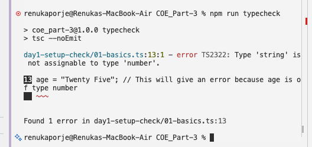
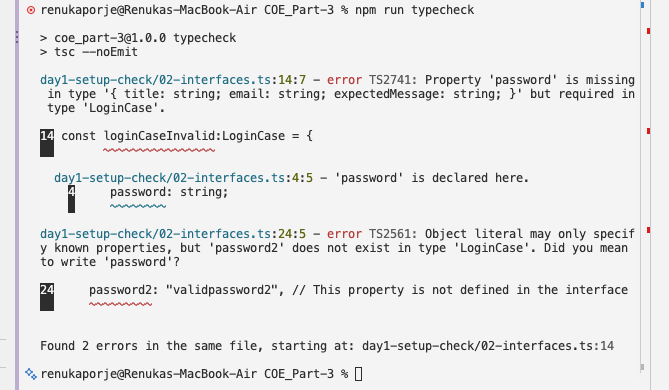
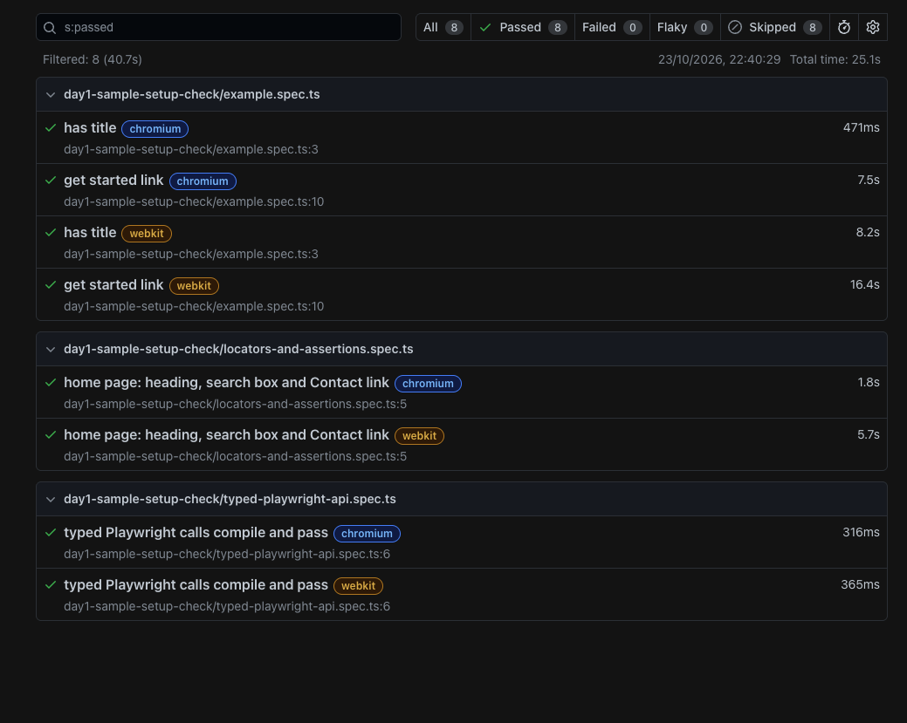
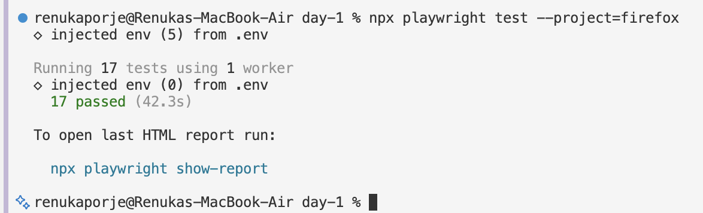
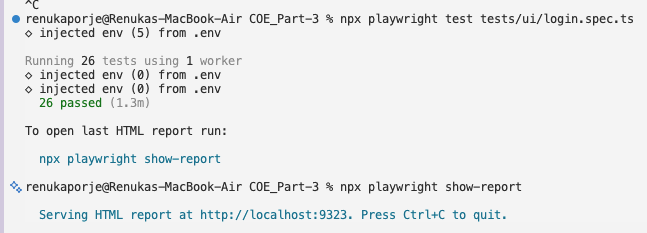

# Part 3 · Day 1: TypeScript & Playwright First Tests

## Success criteria

| **Criterion**                                                  | **Done?** | **Evidence (link or section below)**                                                                                                                                                           |
|----------------------------------------------------------------|-----------|------------------------------------------------------------------------------------------------------------------------------------------------------------------------------------------------|
| Comfortable with TypeScript basics and why it suits Playwright | Yes       | [`day1-setup-check/01-basics.ts`](../code/day-1/day1-setup-check/01-basics.ts) · [`day1-setup-check/02-interfaces.ts`](../code/day-1/day1-setup-check/02-interfaces.ts) · [`day1-setup-check/02-modules.ts`](../code/day-1/day1-setup-check/02-modules.ts) · [`tests/day1-sample-setup-check/typed-playwright-api.spec.ts`](../code/day-1/tests/day1-sample-setup-check/typed-playwright-api.spec.ts) · sections: TypeScript basics, Why TypeScript suits Playwright |
| Runs a Playwright TypeScript project locally                   | Yes       | [`playwright.config.ts`](../code/day-1/playwright.config.ts) · [`assets/practice-tests-report-screenshot.png`](assets/practice-tests-report-screenshot.png) · section: Exercise 1: Project setup |
| Uses role-based locators and web-first assertions              | Yes       | [`tests/ui/login.spec.ts`](../code/day-1/tests/ui/login.spec.ts) · [`tests/day1-sample-setup-check/locators-and-assertions.spec.ts`](../code/day-1/tests/day1-sample-setup-check/locators-and-assertions.spec.ts) · section: Locators and assertions |
| Understands auto-waiting and drops fixed sleeps                | Yes       | [`tests/ui/login.spec.ts`](../code/day-1/tests/ui/login.spec.ts) · section: Auto-waiting |
| Automates a login suite with positive and negative cases       | Yes       | [`tests/ui/login.spec.ts`](../code/day-1/tests/ui/login.spec.ts) · [`tests/support/register-customer.ts`](../code/day-1/tests/support/register-customer.ts) · [`assets/login-test-suite.md`](assets/login-test-suite.md) · section: Exercise 2: Login suite |
| Pushes the work to Git with a clear history                    | Yes       | COE_Part-3 commit history on GitHub                                                                                                                                                          |

## Key learnings

### TypeScript basics

**Core idea:** TypeScript is a statically typed superset of JavaScript. The compiler checks types at compile time and removes them from the emitted JavaScript, so they have no effect at runtime. Valid JavaScript is also valid TypeScript, so what changes is the added checking, not the language.

**Types**

- The primitive types used in test code are string, number and boolean. A type is declared with an annotation, as in let age: number = 25, and the compiler rejects any later assignment that does not match this type.
- A mismatch is reported as TS2322: Type 'string' is not assignable to type 'number'.

**Inference**

- When a variable is initialised, the compiler infers its type from the initial value. let city = "Bangalore" is typed string without an annotation, and a later assignment of a number is an error.
- An explicit annotation is needed where there is no initial value to infer from, and on function parameters. With strict enabled (in this project's tsconfig), an unannotated parameter is an error.

**Interfaces**

- An interface declares the shape of an object, its property names and their types. Compatibility is structural, so any object that has the required properties satisfies it.
- LoginCase example describes the data for one login test: title, email and password as required strings, and expectedMessage? as an optional one.
- A missing required property is reported as TS2741. An unknown property in an object literal is reported as TS2561.
- The excess-property check applies only to an object literal assigned directly to a typed variable. An object assigned from another variable is checked for the required properties only, so an extra property in it is not reported.
[`day1-setup-check/02-interfaces.ts`](../code/day-1/day1-setup-check/02-interfaces.ts)

**Modules**

- A module is a file with its own scope. export makes a declaration available to other files and import brings it in.
- [`package.json`](../code/day-1/package.json) has "type": "commonjs" and the tsconfig uses module: "nodenext", so the files are treated as CommonJS.
- Line 1 of [`tests/ui/login.spec.ts`](../code/day-1/tests/ui/login.spec.ts) already relies on this: import { test, expect } from '@playwright/test'.
- The project's own module is [`tests/support/register-customer.ts`](../code/day-1/tests/support/register-customer.ts). It exports registerCustomer, and [`tests/ui/login.spec.ts`](../code/day-1/tests/ui/login.spec.ts) imports it with import { registerCustomer } from '../support/register-customer'.
- Importing a name that the other file does not export is rejected at compile time.

**How the compiler catches mistakes before a test runs**

- In JavaScript, a type mistake only shows up if the code that uses the value breaks while running, and sometimes not at all. TypeScript checks the code first and reports it before anything runs.
- tsc checks the types and also creates the JavaScript files. tsc --noEmit only checks, which is what npm run typecheck does.
- "strict": true in the tsconfig turns on the stricter checks. The Handbook advises this for a new codebase.

**[`day1-setup-check/01-basics.ts`](../code/day-1/day1-setup-check/01-basics.ts):** I assigned a string to a number variable, and a number to a variable inferred as string. npm run typecheck rejected both.



**[`day1-setup-check/02-interfaces.ts`](../code/day-1/day1-setup-check/02-interfaces.ts):** I defined LoginCase, then omitted a required property in one object and added an unknown property in another, and both were rejected.



In the same file, an object with an extra property assigned to a LoginCase from a variable was accepted, because the excess-property check applies only to object literals.

**[`day1-setup-check/02-modules.ts`](../code/day-1/day1-setup-check/02-modules.ts):** I exported LoginCase from [`day1-setup-check/02-interfaces.ts`](../code/day-1/day1-setup-check/02-interfaces.ts) and imported it here. Misspelling the imported name was rejected with - has no exported member named 'LoginCasse'. Did you mean 'LoginCase'?

**Key Takeaways:** Type errors are reported at compile time, by the editor and by tsc, and the same applies to a bad import. An interface fixes the shape of test data in one place, so a missing or misspelt property in a literal is caught before a test runs, although data that reaches the compiler through a variable is only checked for the required properties. Playwright transforms the files without checking types and does not report type errors during a run, so the check is a separate step.

### Why TypeScript suits Playwright

**Core idea:** Playwright ships its own type definitions, so the TypeScript compiler and the editor can check every call to its API before a test runs, but only how the API is called and not what is on the page.

**Compile-time checking**

- Playwright transforms .ts files to JavaScript and runs them without checking types, so the docs recommend running the compiler alongside it, for example tsc --noEmit on CI. In this repo that is npm run typecheck.
- A wrong argument is rejected at compile time. toHaveTitle(123) fails the typecheck, whereas a plain run reaches that line and fails there.
- The types ship inside Playwright, so nothing extra is installed. node_modules/playwright-core/types/types.d.ts declares Page, Locator and BrowserContext.

**Locator safety**

- The locator methods are typed too. getByRole accepts only valid ARIA role names and its options have declared types, so getByRole('buton') is rejected.
- A locator kept in a variable or a page-object field has the type Locator. A misspelt action, or a method that belongs to Page, is rejected on it.
- The limit: the strings inside a locator, such as label text, a test id or a CSS selector, are not checked against the page. Whether the element exists is only known at runtime, where strictness and auto-waiting apply.

**IDE autocomplete**

- Editors that run the TypeScript language service, such as VS Code, use those bundled types to list the methods and parameters of page, a locator or expect(...) as the code is typed, including the valid roles for getByRole.

**Recommended, not required.** The installer defaults to TypeScript, and the best-practices page recommends TypeScript with linting to catch errors early. Plain JavaScript also works.

[`tests/day1-sample-setup-check/typed-playwright-api.spec.ts`](../code/day-1/tests/day1-sample-setup-check/typed-playwright-api.spec.ts): the valid calls pass. Two lines are kept as comments in the file. getByRole('buton', ...) was rejected with Argument of type '"buton"' is not assignable to parameter of type '"alert" \| "alertdialog" \| ...'. toHaveTitle(123) was rejected with Argument of type 'number' is not assignable to parameter of type 'string \| RegExp'.

With the toHaveTitle(123) line active, npm run typecheck flagged it before any run. Running the test anyway made it fail at runtime with expected value must be a string or regular expression.

**Key Takeaways:** The compiler and the editor check how Playwright is called, such as role names, argument types and locator methods, but not whether a locator finds anything on the page. Playwright does not run that check itself, so npm run typecheck does.

### Locators and assertions

**Core idea:** A locator describes how to find an element, and Playwright looks it up again every time an action or assertion uses it. That is what makes auto-waiting and retries possible. An assertion states what the page should look like, and a web-first assertion keeps checking until it does or the timeout is reached.

**Locators**

Playwright recommends these built-in locators, and the docs list getByRole first. The best-practices page says to prefer user-facing attributes over CSS or XPath.

- getByRole is the first choice because it finds an element the way users and assistive technology see the page. A CSS selector breaks when the markup changes, whereas a role locator is less likely to.
- getByLabel, getByPlaceholder and getByText cover form fields and visible text. Labels suit the email and password fields. getByText matches a substring by default, and it suits messages and headings more than controls.
- getByAltText and getByTitle find images by alt text and elements by their title attribute, and come up less often.
- getByTestId is the most resilient, because a test id does not change when the text or the role does, but it is not user-facing, so it fits elements that role, label or text cannot identify. The attribute is data-testid by default and can be changed in the config.
- page.locator() with CSS or XPath is the last resort. It depends on the page structure, so it breaks when the markup changes.

**Role-based locators**

- A role describes how an element is perceived by a user or a screen reader, for example as a button, textbox, checkbox, heading or link. Many HTML elements already have one, so \<button\> is a button and \<h3\> is a heading, with no role attribute needed.
- The accessible name is the text that identifies an element, like the text on a button or the label of a field. It is written against name, as in getByRole('button', { name: 'Login' }), which picks the Login button out of all the buttons on the page.
- By default name matches part of the text and ignores case. exact: true matches the whole text and is case-sensitive, and a regular expression such as /submit/i also works.
- Options such as checked, disabled, expanded, pressed, selected and level (for headings) narrow the match by state.

Chaining and filtering narrow a match down. getByRole('listitem').filter({ hasText: 'Product 2' }).getByRole('button', { name: 'Add to cart' }) finds the Add to cart button inside the Product 2 list item only.

Locators are strict. If a locator matches more than one element, an action such as click() throws an error, for example getByRole('button') on a page with several buttons. Picking one match by position with first(), last() or nth() is possible, but the docs advise caution, because a changed page can make Playwright act on a different element.

**Assertions**

- A web-first assertion is written as await expect(locator).toBeVisible(). Playwright fetches the element again and repeats the check until the condition holds or the timeout is reached. The default is 5 seconds and it can be set once in the config. The await has to be there because the assertion is asynchronous, and without it the test moves on before the check has finished.
- Some of the main ones: toBeVisible, toBeHidden, toBeEnabled, toBeDisabled and toBeChecked for state; toHaveText (the element's text matches, with whitespace normalised), toContainText and toHaveValue for content; toHaveURL and toHaveTitle for the page; toHaveCount for lists.
- Generic matchers such as toBe, toEqual and toContain do not retry. They suit plain values, such as data from an API response, and not page state. expect(await locator.isVisible()).toBe(true) reads the state once and returns immediately, and the best-practices page marks it as the wrong pattern.
- .not reverses an assertion, as in await expect(locator).not.toContainText('text').

**Key Takeaways:** Locate elements by role, label or text first, then test id, and use CSS or XPath only when nothing else identifies the element. Assert with awaited web-first assertions and not with manual checks on a value read once.

### Auto-waiting

**Core idea:** Before an action, Playwright runs a set of actionability checks on the element and waits for all of them to pass, then performs the action. If they do not pass within the timeout, the action fails with a TimeoutError.

**Actionability checks**

Before click(), Playwright checks that:

- the locator resolves to exactly one element;
- **Visible**: the element has a non-empty size and is not visibility:hidden. display:none and zero-size elements are not visible, while opacity:0 still counts as visible;
- **Stable**: the element has kept the same position and size for two animation frames in a row, so it is not still moving;
- **Receives Events**: no other element, usually an overlay, covers the point where the click will land;
- **Enabled**: the element is not disabled;
- **Not Inert**: the element is not in an inert part of the page, for example outside a modal dialog that is open.

One more check, **Editable**, applies to fill(). The element must be enabled and not read-only.

Each action runs only the checks it needs:

| **Action**       | **Checks it waits for**                              |
|------------------|------------------------------------------------------|
| click(), check() | Visible, Stable, Receives Events, Enabled, Not Inert |
| fill()           | Visible, Enabled, Editable, Not Inert                |
| hover()          | Visible, Stable, Receives Events                     |
| focus(), press() | None                                                 |

**Why fixed sleeps are not needed**

- Playwright's docs say there is no need to add manual waits or deal with race conditions. Their example is a Sign Up button that is disabled while the page checks the user name with the server, and is then replaced by an enabled one. click() waits until it is enabled.
- A fixed sleep such as waitForTimeout waits for a set time whether or not the page is ready, so it is either too short and flaky, or longer than needed and slow. Auto-waiting and web-first assertions wait for the actual condition and move on as soon as it is met.

**Key Takeaways:** Playwright waits for the element to be ready before acting and retries assertions until they pass, so a test waits for conditions and not for a fixed time.

## Exercises

### Exercise 1: Project setup

The project is a Node project in COE_Part-3/code/day-1 with typescript, @playwright/test, @types/node and dotenv as dev dependencies. TypeScript has its own [`tsconfig.json`](../code/day-1/tsconfig.json) with strict mode on. Playwright was added through its installer, which generated [`playwright.config.ts`](../code/day-1/playwright.config.ts) and a sample test.

The config reads BASE_URL from .env and runs three projects, chromium, firefox and webkit. Four npm scripts cover the daily work: test, test:ui, report and typecheck. The sample test was run and the HTML report opened, as shown below.



**Firefox launch issue (resolved).** Firefox failed to launch locally on macOS with the error Could not find profile folder, so I commented the firefox project out of [`playwright.config.ts`](../code/day-1/playwright.config.ts) for a while. A [Playwright issue](https://github.com/microsoft/playwright/issues/42768) explains the cause: the bundled Firefox shares its data folder with an installed Firefox, which macOS protects, so a terminal or editor launching it is blocked. As the issue suggests, I added VS Code to Full Disk Access in System Settings, under Privacy & Security, and Firefox launched. The sample tests and the login suite now pass on it, 17 in 42.3 seconds.



### Exercise 2: Login suite

**App under test:** Practice Software Testing (Toolshop), <https://practicesoftwaretesting.com>

**Scope:** all 13 cases are automated in [`tests/ui/login.spec.ts`](../code/day-1/tests/ui/login.spec.ts). The case design and the test data are in the test cases file linked below. The suite covers positive and negative cases, the lockout after three failed attempts, logout, and the navigation links on the login page.

**Test cases:** [`assets/login-test-suite.md`](assets/login-test-suite.md)

**Choices that shaped the tests**

- Starting point: a beforeEach hook opens the login page before every test, so each test starts from the same page.
- Test data: the valid email, password and customer name come from .env (USER_EMAIL, USER_PASSWORD and USER_FULL_NAME), so neither the tests nor the suite hold credentials. The unregistered email in TC_07 and the customers in TC_08 and TC_09 are built from the current time, and a wrong password is the valid one with an x added at the end.
- Independence: TC_02 and TC_03 make their own failed attempts and finish with a successful login, which resets the counter on the shared demo account. TC_08 and TC_09 register a customer of their own, because failed attempts count against an account and the lock is permanent.
- Registration: one function, registerCustomer in [`tests/support/register-customer.ts`](../code/day-1/tests/support/register-customer.ts). It fills the registration form through the UI, with fixed values for the name, address and phone that do not affect what the tests check, and both tests import it. It waits for the address lookup response before filling street, city and state, because the lookup can overwrite what is typed next. The password field is found with \[data-test="password"\], a CSS locator, because its label points at a custom component and not the input. Day 2 can replace its body with an API call.
- Waiting: in TC_03 and TC_09 the message from the previous attempt is still on screen, so a visibility check cannot show that the next attempt was counted. The test waits for the login response instead.
- Locators: fields use getByLabel, buttons and headings use getByRole. Validation messages are checked with toHaveAccessibleDescription, so each message is tied to its field.
- Workers: [`playwright.config.ts`](../code/day-1/playwright.config.ts) sets workers to 1. The login tests share one demo account, and failed attempts from two projects at the same time would add up towards the lock.

**What broke and how it was fixed**

- TC_01 first asserted the page title. The title includes the site version, and may lead to a flaky check if ever changed, so the assertion was removed.
- TC_04 first looked for Sign out with getByRole('link'). It timed out after 30 seconds. The failure snapshot showed Sign out as a plain element with no link role, so the test finds it by its text inside the account dropdown.
- The shared demo customer was locked once, probably by other users of the public site. TC_01 to TC_04 failed together, and all passed once the credentials in .env were changed to another demo customer.

**How to run:**

```bash
cd COE_Part-3/code/day-1
npx playwright test tests/ui/login.spec.ts
```

**Result:** 26 passed in 1.3 minutes on one worker, which is 13 tests on each of the two projects enabled at the time, chromium and webkit.



## Reflection

Most of the manual design carried straight over. Each login case still has preconditions, steps and an expected result, positive and negative cases are still split, and the cases are still picked by risk, such as the lockout after three failed attempts. The invalid inputs stayed the same kinds too: an email in the wrong format, an unregistered email and a wrong password.

What needed rethinking was how exact everything has to be. In manual testing, "locked", "blocked" and "error shown" all mean the same thing to the person running the test, and a spoiled account can be repaired by hand. A script can do neither, so every term had to mean one thing, every expected result became the exact message on screen, and the test data had to work on every run.

The biggest shift was independence, and it reached the test data as well. Manually you can chain cases along one journey, but an automated test has to set up its own state and cannot rely on another test having run first. The demo customer is shared, failed attempts count against it and the lock is permanent, so TC_08 and TC_09 register a customer of their own. TC_07 builds an email from the current time, which no existing customer will have.

A person running a test notices odd things beyond the expected result, but a test only checks what it asserts, so each assertion is a deliberate choice. I also judge a page by what it shows, while Playwright works from what the page exposes: Sign out looked like a link in the Elements panel and in codegen, but the test failed on it, because the snapshot showed no link role.

Timing is something I never had to think about manually, because a person sees the page settle. In TC_03 the error message from the first wrong password was still on screen, so a visibility check could not show that the second attempt had reached the server, and the test had to wait for the login response.

## AI use

I used Claude in these ways:

- Explaining topics where a resource was hard to follow. I gave the resource as context, asked for examples, and followed up on specific concepts.
- Troubleshooting during installation and setup. The Firefox launch error was not resolved with that help, and I found the cause myself later, as written up in Exercise 1.
- Reviewing the login test suite test cases and getting help with test data, such as the unregistered email in TC_07.
- Structuring and formatting this document, and drafting some sections from findings, notes, exercises, and results. Which I then checked against my own understanding, the resources and my notes.
- Clarifying behaviour while writing the tests: which locator to use, in case the tests couldn't find the locator and timed out, how to show that a second failed attempt reached the server, and why a test failed.
- A final review of the document.

Claude suggested creating a fresh customer before every test case, including the valid-credentials case. That was not needed, because the site provides demo accounts, so I used the demo customer for valid logins and fresh customers only for the lockout and wrong-password cases, where failed attempts count against the account.

For TC_07 I did not know how to build an email that no customer could have registered. Claude explained the approach: the current time in milliseconds on example.com, a reserved domain, because a fixed address is unsafe on a public site where anyone can register. It wrote the line, and I had it explained piece by piece before I kept it.

For TC_04, Sign out showed as a link in the Elements panel and in codegen, but the test failed. I asked Claude for possible causes and later realised it is not a link (even if it showed as link in dev tools), so I wrote the dropdown version: the test looks for the list and then finds Sign out inside it. I also asked Claude to compare the test with the case, and it showed an assertion I had missed, that the customer's name is hidden after sign out, shows 'Sign In' again instead.

In TC_03 I could not see how to prove that the second wrong attempt reached the server, because the error message from the first one was still on screen. Claude explained why a visibility check cannot show that, and I wrote the waitForResponse approach with its help.

Claude wrote TC_08 and TC_09 with the registration steps repeated in each. I rejected that as poor structure and asked for the right approach. Claude suggested helper functions or creating the users in line, which also seemed poor structure, so I wrote a function in the test file and later moved it into a module. Claude also said that sharing one customer between the two tests could break half the time under random order, and I corrected that, because tests in one file run in order.

Claude's review of my tests found real problems: the title assertion, a not-visible check that could pass too early, a missing await, and a wrong role.
