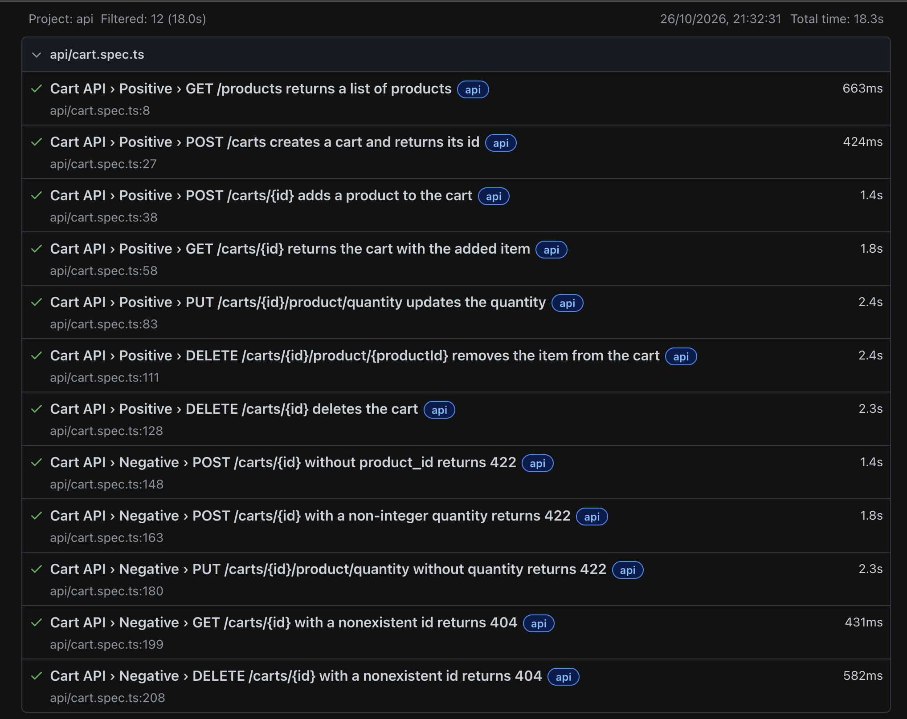
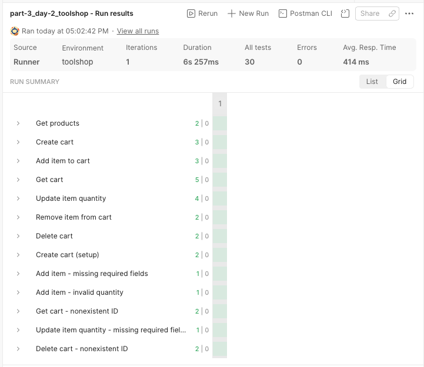
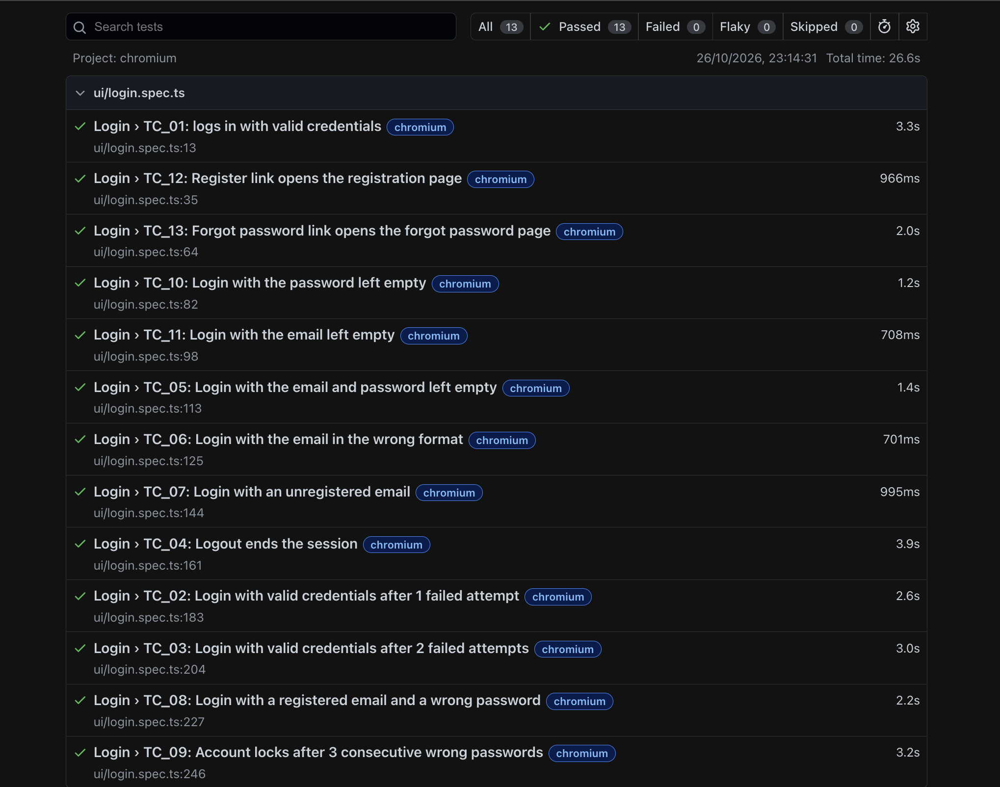
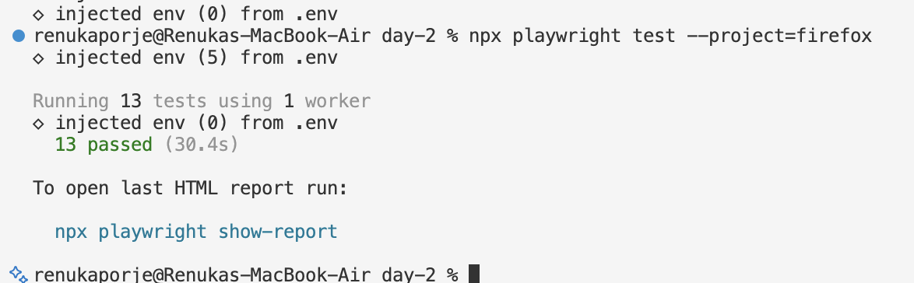

# Part 3 · Day 2: API Automation

## Success criteria

| **Criterion** | **Done?** | **Evidence (link or section below)** |
|---|---|---|
| Uses the request fixture for direct API tests | Yes | [`tests/api/cart.spec.ts`](../code/day-2/tests/api/cart.spec.ts) · [`playwright.config.ts`](../code/day-2/playwright.config.ts) · [`assets/playwright-api-test-html-report.png`](assets/playwright-api-test-html-report.png) · sections: The request fixture, Exercise 1 |
| Rebuilds a collection as code with meaningful assertions | Yes | [`postman/collections/part-3_day-2_toolshop`](../code/day-2/postman/collections/part-3_day-2_toolshop) · [`tests/api/cart.spec.ts`](../code/day-2/tests/api/cart.spec.ts) · [`tests/support/cart-api.ts`](../code/day-2/tests/support/cart-api.ts) · [`assets/postman-run-summary.png`](assets/postman-run-summary.png) · [`assets/playwright-api-test-html-report.png`](assets/playwright-api-test-html-report.png) · section: Exercise 1 |
| Uses API calls for fast UI test setup | Yes | [`tests/ui/login.spec.ts`](../code/day-2/tests/ui/login.spec.ts) · [`tests/support/register-customer.ts`](../code/day-2/tests/support/register-customer.ts) · [`assets/api-calls-for-test-setup-report.png`](assets/api-calls-for-test-setup-report.png) · sections: API calls for fast test setup, Exercise 2 |
| Explains what stays in Postman and what belongs in code | Yes | [`postman/collections/part-3_day-2_toolshop`](../code/day-2/postman/collections/part-3_day-2_toolshop) · [`tests/api/cart.spec.ts`](../code/day-2/tests/api/cart.spec.ts) · section: What stays in Postman and what belongs in code |
| Reflects on where API feedback beats the UI | Yes | section: Reflection |

## Key learnings

### The request fixture

**Core idea:** The request fixture lets a test call the API directly, without opening a browser. Each test gets its own request client. It already knows the base URL and headers from the config, so a call only needs the path in test.

- Add request to the test's arguments to use it in the test, like `async ({ request }) => { ... }`. No browser or page is opened, so this test doesn't go through UI at all.
- It can send get, post, put, patch, delete and head requests, and each one returns a response to check.
- Playwright does not treat a 400 or 404 as an error. The call finishes normally and gives back the response, so a negative test can check for the 400 or 404 itself.

**Responses**

- status() gives the status code, headers() the headers and json() the body. ok() is true for any 2xx.
- A 204 response has no body and json() fails on an empty body, so for the delete calls text() can be used instead.
- Playwright does not have a built-in way to check a body against a JSON schema or the full shape of the response, so the fields and their types are checked one by one in the response body.

Eg.: request.post('/carts') returns 201 with an id. A POST without product_id comes back as a normal 422 response, so that negative test checks expect(response.status()).toBe(422) and then reads the cart again to confirm nothing changed.

The Fixtures reference lists six:

- page is a new browser page for each test. It is the one used most in UI tests, and it opens in a new context of the shared browser, so each test starts with a fresh state.
- context is a new browser session for each test, like a fresh incognito window. The page opens inside it.
- browser is one browser shared by all the tests in a worker, so each test does not have to start its own.
- browserName is the name of the browser the test is running on, chromium by default. It is useful for skipping a test on one browser.
- request is a new API client for each test. This is the one the API tests here use, and it is also used to set up test data through API calls instead of the UI.
- mount is for component testing. It shows one UI component on its own test page, which has to be served at the base URL. I have not used it.

**Key Takeaways:** With the request fixture, an API test is a call to a path, with the API URL already in the config, and a check on the response. This is really helpful if you want to prepare your server state before the test runs. It can also be used to check post conditions on the server after performing certain actions in the browser.

### API calls for fast test setup

**Core idea:** A UI test can set up its data with API calls, so the test only covers the page being tested, and its actual assertions. The API calls can run inside the UI test, before or after the browser steps.

- Before: creating the data with an API call inside the test, then verify it in the browser. The docs create a GitHub issue this way and check that it shows at the top of the repository's issues list.
- After: perform the steps in the UI, then check the result with an API call. The docs read the issue number from the URL and check the title with a GET request.
- Logging in once: a test can also log in with an API call and save the login state to a file, which the docs call storage state. Later tests then start already logged in and skip the login steps in the UI.

**Key Takeaways:** API setup takes repeated UI steps out of a test, creates the data, and a saved storage state takes out the repeated login. In my login tests the API replaced the registration form and the failed attempts.

### What stays in Postman and what belongs in code

**Core idea:** From my understanding, both tools can send a request, check the response, run in CI and keep their files in Git, so none of that decides where a check lives. What decides it is whether the check needs something from the UI suite or something only Postman gives.

- The same cart checks are written in both, Postman and Playwright tests: 7 positive and 5 negative. Postman has one extra request that creates a cart for the negative tests for test data set up. Playwright does the same with the `createCart` helper instead.
- Postman ran its 13 requests in 6.3 seconds and Playwright ran its 12 tests in 18.3. By sheer number of API requests, Playwright sends about 38 requests against the 14 in Postman, because each test creates its own cart and picks a product, while Postman reuses the ids from earlier requests, by chaining the requests.
- Without the `Accept: application/json` header, the 422 cases came back as a 404 "Resource not found". Postman needed the header added to all 13 requests, while Playwright sets it once, in the api project of the config.
- After a change, in some tests, you must read the cart again to check what actually happened. In Postman that is a `pm.sendRequest` call inside the request's script, and in Playwright it is one more line in the test.

**Stays in Postman**

- Postman can be helpful to build initial collections, organise them by features, and endpoints, also allowing you to chain requests, which can be helpful when testing an end-to-end user journey. So exploring the API endpoints, with saved examples in a shared collection can be done in Postman.
- Postman also offers Alerts and mocks. Scheduled runs and monitors run the collection in Postman Cloud on a schedule, and a monitor can notify when a run fails. A mock server stands in for a real backend.
- The JSON schema check, `pm.response.to.have.jsonSchema`, is something Playwright does not have built in, from what I understand in the docs, so there you have to check every field in the body.

**Belongs in Playwright tests**

- Setting up data for a UI test, or checking it afterwards, is better done in Playwright, because the same test can call the API and then use the browser. My login tests do this. The customer is registered through the API, along with the preconditions where required, and the login itself is done in the UI.
- Checks that reuse code from the suite also belong here. The login tests, for example, call `registerCustomer` from [`tests/support/register-customer.ts`](../code/day-2/tests/support/register-customer.ts).
- Chained requests work differently in the two tools. Playwright tests should not depend on each other, so create cart, add item and read cart became separate tests, and each one creates its own cart. Postman runs the chain in the order you set, which suits an end-to-end journey, but if one request fails, the ones after it can fail too.

**Either:** Checks that stand on their own, like the cart's positive and negative checks. Ask whether the check needs something from the UI suite (shared code, data, login state, the same CI run and report) or something only Postman gives (a hosted schedule with alerts, a shared collection). If neither, pick one place and do not keep the check in both. I kept the cart checks in both only to compare.

**Key Takeaways:** Exploring, mocks, alerts and the schema check can stay in Postman. Anything that feeds or follows a UI test can be done in Playwright. The cart checks work in either tool, and the Playwright version sends more requests because each test is independent, setting up its own data and pre conditions before running the test, also verifying the post conditions where necessary.

## Exercises

### Exercise 1: Rebuild the Postman collection as Playwright API tests

**App under test:** the Toolshop cart API, <https://api.practicesoftwaretesting.com>

**Scope:** my Postman collection [`part-3_day-2_toolshop`](../code/day-2/postman/collections/part-3_day-2_toolshop) has 13 requests. I rebuilt it as 12 tests in [`tests/api/cart.spec.ts`](../code/day-2/tests/api/cart.spec.ts), 7 positive and 5 negative, with three setup helpers in [`tests/support/cart-api.ts`](../code/day-2/tests/support/cart-api.ts).

- Config: the api project in [`playwright.config.ts`](../code/day-2/playwright.config.ts) sets the base URL from API_URL and the Accept header for every call. The chromium, firefox and webkit projects only pick up `tests/ui`, so API and UI tests never mix.
- Test data: the cart id comes from POST /carts and the product id from GET /products, both inside helpers, so no id is typed into a test. The only typed values are inputs, such as quantities 1 and 3, the invalid quantity 'abc' and a nonexistent cart id made of zeros.
- Assertions: status code, content type, the fields in the response with their types, and the exact message "item added or updated". If the API rewords that message the test will break, and I accepted that because it is the documented message.
- Post-condition checks: after the PUT, both DELETEs and the three 422 cases, the test reads the cart again. A status or a message does not prove the cart changed, and a 422 does not prove it was left alone or didn't cause any changes.
- Independence: each test that needs a cart creates its own, so no test depends on another. The carts are never deleted. So there are less chances of a cascading failure, which I noticed in Postman.
- Gap: I did not assert the 422 response body, because the docs do not describe it any further.

Issues encountered, and fixes:

- The 422 cases came back as a 404 "Resource not found" in Postman, because the `Accept: application/json` header was missing. On digging this further, I understand that the Laravel Framework possibly redirects a failed validation to the home page when the request does not ask for JSON. With the header on every request they returned 422 as expected, and in Playwright I set it once in the config.
- The first test timed out once after 30 seconds with "Request context disposed", and passed on the re-runs after. Since I wasn't able to reproduce this, it has been noted as a one-off, but something to look out for.

**Result:** 12 passed in 18.3 seconds. The Postman run of the same checks passed all 13 requests and 30 tests in 6.3 seconds.

### Exercise 2: Create the login test data through the API

**Scope:** I copied the Day 1 login suite into Day 2 and changed four of its tests in [`tests/ui/login.spec.ts`](../code/day-2/tests/ui/login.spec.ts). TC_08 and TC_09 used to register their customer through the registration form in UI itself, and TC_02 and TC_03 used to make their failed attempts through the login form, on the shared demo account. All four still assert on the page.

- Registration: `registerCustomer` in [`tests/support/register-customer.ts`](../code/day-2/tests/support/register-customer.ts) keeps its name but now takes the request context, an email and a password, and posts to `/users/register`, expecting 201. The URL comes from API_URL because the UI projects use the website as base URL, and the Accept header is set in the call because only the api project gets it from the config.
- Failed attempts: `createFailedAttempt` posts a wrong password to `/users/login` and checks for a client error, not a server error.
- Customers: TC_02 and TC_03 now register their own customer, as TC_08 and TC_09 already did, so failed attempts no longer count against the shared demo account. TC_01 and TC_04 still use the demo account through the UI, because login and logout are what they test. So the chances of failures due to locked shared demo accounts, since it's a public demo site, are less.
- Storage state: not used. TC_04 is the only test that starts logged in, and it logs in once through the UI. It is the one place where an API login with saved state could replace UI steps.
- But TC_09 no longer checks the UI error message after its first wrong attempts, because they now go through the API. TC_08 still checks it for one wrong attempt.

Issues encountered, and fixes:

- TC_09 failed once its failed attempts moved to the API, and the HTML report showed "Email is required" on the page. The old UI loop had filled the email field on every attempt, which the API calls do not do, so the test now fills the email before the password.

**Result:** 13 passed on chromium in 26.6 seconds.

**Result on firefox:** 13 passed in 30.4 seconds.

## Reflection

The API tests gave me slightly faster feedback, and they showed which request had failed. The 12 cart tests ran in 18.3 seconds with no browser. When the Accept header was missing, Postman showed a 404 on the exact request, so I knew where to look, whereas a UI failure like TC_04 on Day 1 only showed up as a 30-second timeout. The 404 was still misleading, because I expected a 422. But this was resolved on fixing the missing header. The API also let me test what the UI would not let me send easily, like a missing product_id, a quantity of 'abc' or a cart id that does not exist, and then read the cart again to see what the server actually did.

The bigger gain was in the test data. On Day 1 the registration form needed a wait for the address lookup, and the shared demo account was locked once. Now the four login tests register their customer with an API call, and TC_02, TC_03 and TC_09 make their failed attempts the same way, on their own customer. This I believe makes it cleaner, and improves readability too, so you only have the UI tests and assertions in the tests. The test data is set up afresh for each test that needs a customer (TC_01 and TC_04 still use the demo account), and also the pre-conditions, leading to less chances of failures spanning tests, in case one test fails.

In Playwright, each test gets its own API client from the request fixture and creates its own cart where it needs one, so no test depends on another. In Postman, the Positive requests pass ids to each other, so they depend on the run order. The API cannot see the page though, TC_09 lost its UI error message check after the first wrong attempts, and the missing email only showed up when the test failed.

## AI use

I used Claude in these ways:

- Explaining parts of the Playwright and Postman resources that I could not follow, with examples of how they can be implemented.
- Reviewing my postman collection, checking them against the Toolshop API docs, which led to the Accept header fix. This was because I kept asserting a 422 as per the API docs, but the missing header kept giving a 404.
- Reviewing my tests and helpers, and troubleshooting, after using request fixture for test data set up for my day 1 login suite
- Structuring, formatting this document and initial drafts for certain sections from my notes, tests/collections and the results, which I then checked against reports, test results my own understanding and resources linked in planner.
- A final review of the document, assets and functional links and markdown.

Cases where I corrected Claude:

- Failed attempts through the API: in the tests review by Claude, it suggested that I keep failed attempts in the tests itself, through the UI, since they check the UI message for failed attempt as well. I pointed out that they are pre-conditions setup and can go through the API, which is why I had created `createFailedAttempt`.
- Claude suggested in review, I should register a new customer with unique details through beforeEach, I rejected this, because some scenarios, use valid set up demo accounts from the site itself, and some do not need a valid account at all, just invalid credentials.
