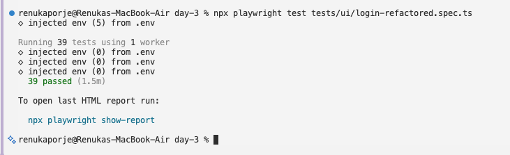
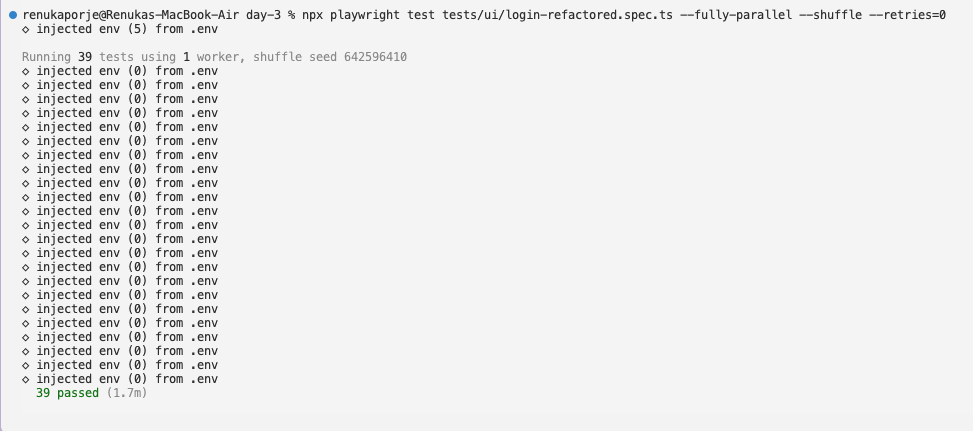
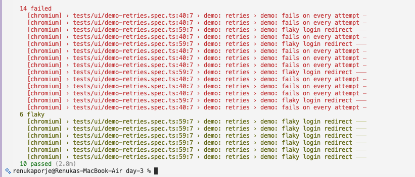
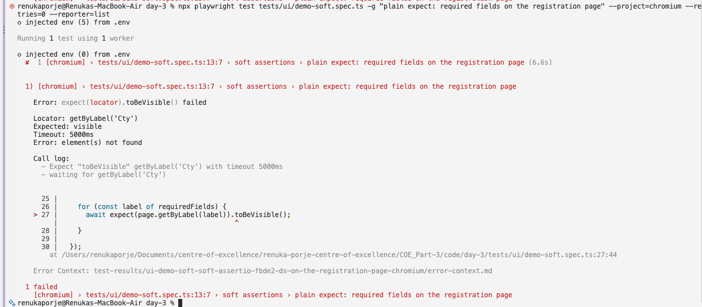
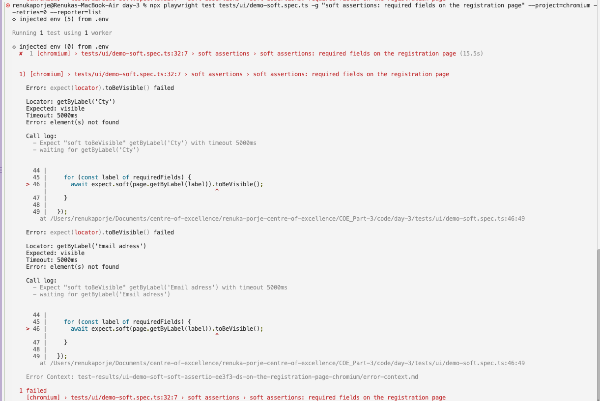

# Part 3 · Day 3: Structure & Stability

## Success criteria

| **Criterion** | **Done?** | **Evidence (link or section below)** |
|---|---|---|
| Separates locators and actions from assertions with page objects | Yes | [`tests/pages/login-page.ts`](../code/day-3/tests/pages/login-page.ts) · [`tests/pages/account-page.ts`](../code/day-3/tests/pages/account-page.ts) · [`tests/ui/login-refactored.spec.ts`](../code/day-3/tests/ui/login-refactored.spec.ts) · [`assets/refactored-cross-browser-run.png`](assets/refactored-cross-browser-run.png) · sections: Page Object Model, Exercise 1 |
| Explains fixtures versus page objects | Yes | [`tests/ui/login.spec.ts`](../code/day-2/tests/ui/login.spec.ts) · section: Fixtures and how they differ from page objects |
| Writes isolated tests that run in any order | Yes | [`tests/ui/login-refactored.spec.ts`](../code/day-3/tests/ui/login-refactored.spec.ts) · [`assets/cross-browser-run-shuffle.png`](assets/cross-browser-run-shuffle.png) · sections: Test isolation, Exercise 2 |
| Names common causes of flakiness | Yes | sections: Common causes of flakiness, Reflection |
| Configures retries and soft assertions appropriately | Yes | [`playwright.config.ts`](../code/day-3/playwright.config.ts) · [`tests/ui/demo-soft.spec.ts`](../code/day-3/tests/ui/demo-soft.spec.ts) · [`tests/ui/demo-retries.spec.ts`](../code/day-3/tests/ui/demo-retries.spec.ts) · [`assets/retries.png`](assets/retries.png) · sections: Retries, Soft assertions, Exercise 3 |

## Key learnings

### Page Object Model

**Core idea:** Large test suites can be structured to make them easier to write and to maintain. The Page Object Model is one such approach. A page object stands for one part of a web application. Toolshop, for example, has a home page, a product catalogue, a product detail page and a checkout page, and each of them can be its own page object.

Page objects make the tests easier to write, because a test can call one action on the page, such as logging in, instead of repeating every step. They make the suite easier to maintain, because the element selectors sit in one place and the steps are written once, so a changed label or role is fixed once and not in every test.

In the Playwright example, the page object is a class. It takes the page when it is created, defines each locator once, and has a method for each action, such as goto() and getStarted(). A test creates it from the page fixture, calls its methods and asserts on its locators.

Eg.: In the Day 1 login suite ([`tests/ui/login.spec.ts`](../code/day-1/tests/ui/login.spec.ts)), the password field and the Login button are found with the same locators across 11 of the 13 tests. A login page object would hold those two locators once, with a login action on top of them.

**Key Takeaways:** Locators and actions go in the page object, checks and assertions can go in the test, and a change in the UI is then fixed in one file, that is the page's object.

### Fixtures and how they differ from page objects

**Core idea:** Playwright Test is based on fixtures. A fixture sets up what a test needs to run and nothing more, and each test gets its own, separate from the other tests. Fixtures also let you group tests by their meaning instead of by the setup they share.

- A test gets the page fixture by passing { page } as an argument. Playwright then creates the page and hands it to the test function.
- The built-in fixtures are page, context, browser, browserName and request. Each test gets its own page, which sits inside its own context, so nothing carries over from one test to the next. The browser is the exception, as it is shared across tests to save resources. browserName only tells the test which browser it is running in. The request fixture lets a test call an API directly without opening a page, and it is also separate for each test.
- Fixtures have some advantages over before and after hooks. The setup and the teardown sit together in one place, a fixture is defined once and can be used in any test file, and Playwright sets up only the fixtures a test asks for. Fixtures can also depend on each other, and a test can use any combination of them as well.
- Every fixture has a setup phase and a teardown phase, split by the await use() call in the fixture code.
  1. The code before await use() is the setup, and it runs before the test or hook that needs the fixture.
  2. The test or hook runs and uses the fixture.
  3. The code after await use() is the teardown, and it runs once nothing is going to use the fixture anymore.
- A fixture is created with test.extend(), which returns a new test object that includes it. A test then asks for the fixture by name in its arguments and Playwright does the rest, and fixtures can also be used in hooks and in other fixtures.
- Playwright runs test files in worker processes, so a fixture can also be set up once per worker, which is where services or servers can be started.
- A page object and a fixture do different things. A page object describes a page and what can be done on it, so it can hold the locators, element selectors and the actions. A fixture describes what a test needs around it, and when that is set up and torn down. The Playwright page uses them together: a fixture creates the page object, passes it to the test and cleans up after the await use() call.

Eg.: On Day 2 the request fixture was used to rewrite the Postman collection as API tests. In the Day 2 login suite ([`tests/ui/login.spec.ts`](../code/day-2/tests/ui/login.spec.ts)), TC_02, TC_03, TC_08 and TC_09 take request along with page. The request fixture registers the customer through the API, and in TC_02, TC_03 and TC_09 it also makes the failed attempts. The page fixture handles the UI checks.

**Key Takeaways:** A page object models a page, and a fixture manages what a test runs with. A fixture can build the page object and hand it to the test.

### Test isolation

**Core idea:** Each test should be isolated from the others and run on its own, with its own local storage, session storage, data and cookies. A test should not depend on the order the tests run in.

- Isolation makes failures easier to reproduce and to debug, and it helps to avoid cascading failures.
- The before and after hooks avoid repeating the same steps in every test. A beforeEach hook runs before each test, so in a login test it can open the login page. For an add to cart or checkout test, it can open the login page and log in before going to the checkout. That keeps the tests isolated. The Best Practices page also says a little duplication is fine when the tests are simple enough, especially if it keeps them clearer and easier to read and maintain.

Eg.: In the Day 1 login suite ([`tests/ui/login.spec.ts`](../code/day-1/tests/ui/login.spec.ts)), TC_08 and TC_09 register their own customer, because the lock on the shared demo account cannot be reset until admin does it, after three failed attempts. On Day 2, TC_02 and TC_03 were moved to their own customers as well, which leaves TC_01 and TC_04 as the only tests that log in to the shared account, but these are happy-path tests.

**Key Takeaways:** A test that passes only after another test has run is not isolated, and reliance on test order is one of the causes of flakiness named in the Spotify article.

### Retries

**Core idea:** Playwright can run a failing test again automatically, which helps when a test is flaky. Failing tests are not retried by default, so the number of retries has to be set in the configuration file or on the command line with --retries.

**Failures and how workers run the tests**
- Tests run in worker processes, which are OS processes that run independently, orchestrated by the test runner. Every worker has the same environment and starts its own browser.
- When a test fails, Playwright throws away the worker and its browser, and starts a new one, and what that worker runs first depends on the retries. Take three tests, first good, second flaky and third good, where the second one fails. Without retries, the new worker moves on to third good and the failed test is not run again. With retries on, it runs second flaky again first, which passes, and then third good. Every new worker runs beforeAll again.
- The page says this works perfectly for independent tests and guarantees that a failing test can't affect the healthy ones.

**Retries**
- With retries on, each test is reported as passed, flaky (failed first and passed on a retry) or failed (failed on the first run and on every retry).
- A test, hook or fixture can detect a retry at runtime through testInfo.retry. 
- test.describe.configure() sets retries for one group of tests or a single file.

**Serial mode**
test.describe.serial() groups dependent tests so they run together and in order. If one fails, the ones after it are skipped and the whole group is retried from the first test. The page still says isolated tests are usually better, because they can be efficiently run and retried on their own.

**Reusing a single page**
Playwright creates an isolated Page for each test. To reuse one Page across several tests, create your own in test.beforeAll() and close it in test.afterAll().

**Key Takeaways:** A retry gives a failing test another run, and the flaky result marks the tests that failed first and passed on a retry.

### Soft assertions

**Core idea:** A soft assertion records a failure but lets the test carry on instead of stopping it. The Best Practices page lists them under productivity tips, and the failures are shown as a list when the test ends.

- A failed expect.soft() does not stop the test, but the test is still marked as failed. A normal assertion stops it, and doesn't run any further.
- To stop the test once a soft assertion has failed, add expect(test.info().errors).toHaveLength(0). expect.configure({ soft: true }) creates an expect that is always soft, which you can keep in a variable such as softExpect. Soft assertions work only with the Playwright test runner.
- They suit several independent checks on one screen, where one failure does not impact the rest and should not hide them. In the Day 1 login suite (login.spec.ts), TC_12 checks 12 fields and TC_05 checks two field messages. They do not suit a test where each step depends on the one before, as in TC_04, where the logout checks mean nothing if the login failed.

**Key Takeaways:** A soft assertion reports all failures without stopping the test, and the test still fails at the end.

### Common causes of flakiness

**Core idea:** A flaky test passes and fails from time to time without any change to the code. That is costly and frustrating, because it often means retriggering the whole build on CI and waiting for the new build to pass. The bigger cost is that people stop having confidence in the tests. A team that can't trust its tests is no better than one with no tests. It also hurts the team's ability to deliver continuously with confidence.

- Inconsistent assertion timing: When the application is not in a consistent state between runs, the expect and assert statements fail randomly. The article's fix is to make the test wait for the application to reach a known good state before it asserts, by polling the application and not with wait statements.
- Playwright's web-first assertions already wait for the expected condition, so an error message that appears a few seconds after a click is handled by toBeVisible(). In the Day 1 login suite, TC_03 and TC_09 could not use a visibility check for the next wrong attempt, because the message from the previous attempt was still on screen, so they wait for the login response instead.
- Reliance on test order: Global state can make tests depend on each other. If a test only passes when the whole suite runs, that is the problem, and the fix is to reset the state between test runs and rely less on global state.
- End-to-end tests: they can be flaky by nature, so the article says to write fewer of them, 5 instead of 500.
- Poor locators: A test that depends on the structure of the DOM can fail when the DOM changes, for example when a designer changes a class, so the Best Practices page recommends user-facing locators over CSS or XPath.
- Spotify also built tools around this. Odeneye shows the tests down one side and the runs across the other, where scattered orange dots usually mean flakiness and a whole column of failures usually means an infrastructure problem such as network failures. A simple table of fast, slow and flaky tests brought their flakiness down from 6% to 4% in two months, which is Spotify's own figure. Flakybot lets an engineer check on a pull request whether the tests are flaky before merging to master.

**Key Takeaways:** The sources name inconsistent assertion timing, reliance on test order through shared state, too many end-to-end tests and poor locators.

## Exercises

### Exercise 1: Refactor the Day 1 tests into two page objects

**Scope:** I took the Day 1 login suite as it stands after Day 2, with its setup done through the API, and moved its locators and actions into two page objects. The 13 tests are in [`tests/ui/login-refactored.spec.ts`](../code/day-3/tests/ui/login-refactored.spec.ts), and the page objects are in [`tests/pages/login-page.ts`](../code/day-3/tests/pages/login-page.ts) and [`tests/pages/account-page.ts`](../code/day-3/tests/pages/account-page.ts).

- In LoginPage: 11 locators and 6 actions, such as filling the email and the password and clicking Login.
- In AccountPage: 4 locators and 2 actions, opening the account page and signing out. Its constructor takes the customer's full name, because the name button and the menu are named after it.
- `beforeEach` creates both page objects and opens the login page. `registerCustomer` and `createFailedAttempt` stay as plain helpers.
- The registration and forgot password checks in TC_12 and TC_13 are still in the tests, but I believe that these can also be changed into two other page objects. The 12 required fields in TC_12 are now one loop over a list of labels, which is a cleaner approach and more readable.
- Although the spec file is smaller, implementing the page object model still offers an advantage, since a changed locator can be fixed in one place.

**Result:** 39 passed, the 13 tests on chromium, firefox and webkit with one worker.

### Exercise 2: Run the suite in random order and find dependent tests

**Scope:** the 13 login tests in [`tests/ui/login-refactored.spec.ts`](../code/day-3/tests/ui/login-refactored.spec.ts), after the page object refactor. I did not change any test in this exercise.

- Shuffle: it schedules test files, and tests in parallel mode, in a random order. It also prints a seed, so the same order can be run again. The command was `npx playwright test tests/ui/login-refactored.spec.ts --fully-parallel --shuffle <seed> --retries=0 --reporter=list`. The retries were set to 0, so that a retry could not hide an order problem.
- With seed 629021682 on chromium the order was random, and all 13 passed. I also ran the whole file shuffled four times on all three browsers, and each run passed.
- Concurrent run: `--fully-parallel --workers=4 --retries=0` passed all tests (across chromium, firefox and webkit), and it passed each time I repeated it, 4 times.
- All 13 tests were also run individually, and randomly, which passed by themselves on all three browsers.
- This was expected because only things shared between tests are the values from `.env` and the two page object variables, which `beforeEach` creates again for every test. TC_02, TC_03, TC_08 and TC_09 register their own customer through the API, and only TC_01 and TC_04 use the shared demo account, just to log in.
- I have also noted that these tests can be ordered in numerous ways and I tried a handful. So this shows that I found no dependency, not that none exists.

**Result:** no dependent test found, so there was nothing to fix.

### Exercise 3: Configure retries and soft assertions

**Scope:** two demo files next to the real spec in `tests/ui`. [`demo-soft.spec.ts`](../code/day-3/tests/ui/demo-soft.spec.ts) is the field check from TC_12, and [`demo-retries.spec.ts`](../code/day-3/tests/ui/demo-retries.spec.ts) has variations (in terms of timeout) of TC_01. The real tests are not changed. The tests that fail are commented out so the suite stays green, as they are only to practice and demonstrate how soft assertions and retries work in failures.

- For soft assertions I wrote the TC_12 field check twice, with `expect` and with `expect.soft`. I made two labels wrong on purpose, "Cty" and "Email adress". With `expect` the test stopped at "Cty" and never checked "Email adress". With `expect.soft` both were reported and the test still failed. It also took 15.5 seconds against 6.6, because each wrong label waits its full 5 default seconds.
- I would use `expect.soft` for independent checks, where one failure does not affect or impact the subsequent steps or tests, like the 12 fields in TC_12, and a normal `expect` where later steps depend on it, like the URL after login.
- My real tests never fail, so for retries I made three copies of TC_01 where only the wait on the customer name check changes: 5 seconds, 1 ms and 200 ms. I passed `--retries=2` on the command line, and the config now sets `retries: 2` as well.
- Retries can suit failures that depend on timing, like the 200 ms test, and not a test that fails every time. They can also hide a flaky test if only the pass count is read.

**Result:** on chromium with `--repeat-each=10 --retries=2`, the unchanged test passed all 10 times, the 1 ms test failed all 10, and the 200 ms test was flaky with mixed passes and failures.

## Reflection

The flaky causes I actually spotted were on a public shared demo site, so my observations may not be as accurate as I'd like. The shared demo account was the first: it locks after three wrong passwords, and on Day 1 TC_01 to TC_04 failed together until I changed the credentials. I believe this is shared state, because other users of the public site probably use the same account too, and even one other failed attempt could have locked it, and the lock message says to contact the administrator.

The second was timing in TC_03, where the error from the first failed attempt was still on screen, so a visibility check for the next failed attempt passed without showing that it had reached the server. Another one I noticed was the test order, the Postman requests chain (on Day 2), pass ids to subsequent requests and depend on the run order, so when one test failed due to any reason, it would cause a failure in the other two as well.

But in the Day 3 exercise I found no dependent tests when I shuffled the suite and ran each test alone. Each test gets a fresh page and context, and the tests that change the account state register their own customer, while TC_01 and TC_04 only log in to the shared demo account.

## AI use
- Explaining parts of the Playwright resources that I could not follow, with examples of how they can be implemented.
- Reviewing my tests, and troubleshooting in case of errors.
- Brainstorming with Claude on how to test retries and soft assertions as all my Toolshop tests pass and I could not think of a reliable flaky scenario for the exercise. This helped me understand better if the existing test cases could be reused with wrong labels for soft assertions, and then if a wrong locator or a delay was the right choice to be added to an existing test for retries, and whether this would give me the desired output for the exercise.
- A final review of the document, assets, functional links and markdown.

In Claude's review of my tests:
- In TC_04, it showed that I had written the Sign out locator as a link role. Sign out is an `<a>` without an href, so it has no link role, and it is now found by its text inside the account menu.
- TC_07 first checked `emailError`, which is the wrong message for an unregistered email. It now checks `invalidLoginError`.
- The account locked locator first held the full message, so the "not visible" check in TC_08 would also pass if the wording changed. It now matches only "Account locked", and TC_09 checks the full message with `toContainText`.

For the retries exercise I used TC_01 in demo-retries.spec.ts and changed only how long the check for the customer name on the account page waits after login. Claude insisted 1000 ms would give me a flaky test for that wait during brainstorming. I corrected it, since there was a high chance the tests would mostly pass with this timeout, and that a shorter timeout was needed. I checked and it did pass every time at 1000 ms, while 200 ms gave a mix of flaky and failed runs, which was the desired result.