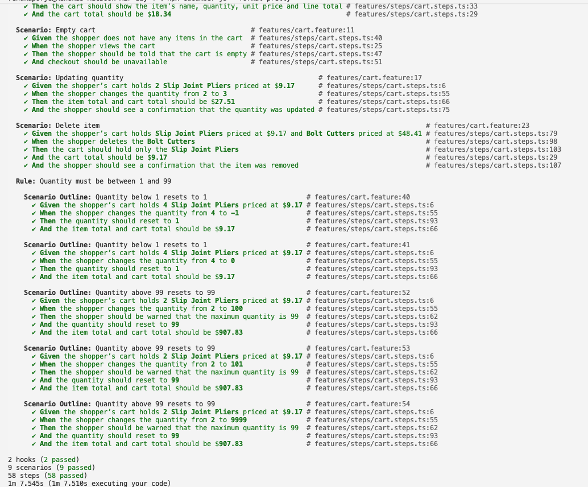

# Part 3 · Day 4: Gherkin to Executable Tests with BEE

## Success criteria

| **Criterion** | **Done?** | **Evidence (link or section below)** |
|---|---|---|
| Automates scenarios with reusable step definitions | Yes | [cart.feature](../code/day-4/features/cart.feature), [cart.steps.ts](../code/day-4/features/steps/cart.steps.ts), [cart-page.ts](../code/day-4/features/pages/cart-page.ts), [cart-api.ts](../code/day-4/features/support/cart-api.ts). Sections: Writing reusable step definitions, Automating five scenarios using Cucumber with Playwright. Screenshot: [test-run-all-pass.png](assets/test-run-all-pass.png) |
| Keeps scenarios in business language | Yes | [cart.feature](../code/day-4/features/cart.feature). Sections: Gherkin, executable specifications and business language, Automating five scenarios using Cucumber with Playwright |
| Uses BEE and reviews its output critically | Yes | [cart.steps.ts](../code/day-4/features/steps/cart.steps.ts), [cart-page.ts](../code/day-4/features/pages/cart-page.ts). Section: BEE, drafting step definitions and review |
| Decides the right level for each scenario with reasons | Yes | Section: Exercise 3: UI, API or manual for one scenario |
| Reflects on how automation changes scenario writing | Yes | Section: Reflection |

## Key learnings

### Gherkin, executable specifications and business language

**Core idea:** A scenario is written in plain business language, and Cucumber makes it executable by matching the text of every step to a step definition, which is the function that actually does the work. So from what I understand, the same scenario ends up being the documentation, the specification and the test, and it stays in business language because how it is done sits in the step definitions and not in the scenario itself.

**Gherkin to executable specifications:**
- A scenario can be written in short steps where Given establishes or puts the application into a known state, When lays out the condition, action or the event that would trigger a behavior in the system. While Then will say what the expected result or output should be, to put it simply, the system behavior for this particular scenario.
- Step definition: It's a function that includes an expression that can link to one or more steps in your Gherkin scenarios. So when Cucumber executes a Gherkin step, it looks for a matching step definition to execute.
- A step definition can take values from the step text, such as {int} or {float}. A function for a Then step definition can use an assertion to compare the actual outcome against the expected one, if this fails, the scenario fails, naturally.
- Cucumber runs one step at a time, in the order they are written. For each step, it will look at everything trailing the keyword to find the matching step definition. The keyword itself is ignored, which is why it's important to note that if the trailing text inside your two keywords stays the same, it ends up being considered a duplicate. For example (Gherkin reference's own):
    These are considered duplicate steps - 
    Given there is money in my account
    Then there is money in my account

    Rather than being a limitation, this pushes one to write appropriately unambiguous and clear business/domain language that will allow distinct steps establishing the known state and the expected output or result respectively.

    So, the version below fixes this,
    Given my account has a balance of £430
    Then my account should have a balance of £430

- A state can pass between steps in a scenario, but the docs advise against having a shared state across scenarios, or passing it to subsequent scenarios. So each one should get a fresh state, and stay independent.
- These scenarios or examples thus end up serving as documentation, a specification. Apart from this they are also a test of it. So from what I understand so far, as a whole these examples form the executable specifications of the system.

**Why they stay in business language:**

- The blog on BRIEF says that as part of a delivery process, these scenarios are documentation first, so they should allow the business and the delivery teams to collaborate with ease and remove misunderstanding, which eventually I believe will ensure an alignment across everyone working on the software.
    The words in the scenarios should be from its business domain, otherwise you may not be able to engage the business team well enough, so it's important the words used are understood by business and everyone involved unambiguously.
- BRIEF is Business language, Real data, Intention revealing, Essential, Focused and finally `Brief` itself.
    The Gherkin reference says any user interaction must stay out of Given, and implementation details or the mechanics or how it happens should stay in step definitions and not in Gherkin scenarios.
    Another important point to note here would be that the Then should have an output that is measurable and observable. But it shouldn't talk about checking a database record as the result. So even if it's tempting to include the specific UI details or backend details to check, it strictly advises against this. It could look like a message or a report as an output.
- The introduction to the Formulation books says that if the manual test scripts need to be automated, using Cucumber to do this may give little return. But adopting BDD as an approach, Gherkin scenarios and Cucumber as a development process itself, in the way the team works, can offer great ROI, in terms of quality, shared understanding and how it can guide developers in development itself. It also serves as living documentation, which is reliable since it is validated against the system every time it is built.

**Key Takeaways:** Cucumber only looks at the text after the keyword, so two steps with the same text end up being duplicates, and each step needs its own distinct wording. Scenarios are documentation first and a test second, which is why the UI mechanics and how it is done stay out of them. BRIEF is what helps keep them clean, and just automating manual test scripts through Gherkin gives little return.

## Exercises

### Automating five scenarios using Cucumber with Playwright

**Scope:** Part-2_Day-3 scenarios for 5 scenarios from Manual COE ([Part-2_Day-3](../../COE_Part-2/Part-2_Day-3/Part-2_Day-3.md)), and the final version is in [cart.feature](../code/day-4/features/cart.feature)
(Exercise: Gherkin scenarios for an e-commerce checkout)

**Keeping these in business language:**
They are in business language and look clean against the anti-patterns, with no UI wording, the intention is revealed, they are brief with a max of 5 steps, and BRIEF is mostly met.

Although they already followed the business language, the few things that were found and corrected were:
- Real data: “An item” has no actual name (Scenarios in the latest exercise follow this, in Part-2_Day-8), so “the cart should show the item’s name” cannot be checked until the scenario names one from actual products.
- Real data (prices): “An item priced at $10.00” and “a $15.00 item” assumed Toolshop has products at exactly those prices, so automating forced either finding products at those prices or rewording the scenario. The Givens now say "priced at $9.17", so the scenario only holds while Toolshop has that product at exactly that price. BRIEF lists this as an anti-pattern, a scenario that relies on specific data existing. I kept the prices because the totals can't be understood without them, and the Givens check the stated prices against the live ones, so a price change on the site now shows up as a data error at the Given and not as a wrong total.
- Business language (same check, same wording): Updating quantity said "should be updated to $27.51" while the outlines said "should be $9.17", which is the same check written two ways. Cucumber treats different wording as a different step, so I used one wording for all of them.
- Sequence of the warning: in the above 99 outline the warning was the last line, which is how I would have checked it manually. But the system shows the warning first, then resets the value to 99, and only then shows the confirmation. Since automated steps run in order, the scenario had to follow the same sequence, so the warning now comes first. Below 1 has no warning at all, the value just resets to 1, which is why that outline only checks the reset.
- Essential (confirmation message): the confirmation that the quantity was updated was also in both Rule outlines. It is an essential check in Updating quantity, and a great one in manual testing, but it is incidental to the two outlines, where the rule is that an invalid quantity resets to the nearest valid one. BRIEF says anything that doesn't directly show the rule should be removed, so I removed it from both outlines and kept it in Updating quantity.


```gherkin
Feature: Checkout Flow - Cart review
  User story: As a shopper, I want to be able to access the cart
    so that I can review that the cart details are correct.

  Scenario: Display cart contents
    Given the shopper’s cart holds 2 Slip Joint Pliers priced at $9.17
    When the shopper views the cart
    Then the cart should show the item’s name, quantity, unit price and line total
    And the cart total should be $18.34

  Scenario: Empty cart
    Given the shopper does not have any items in the cart
    When the shopper views the cart
    Then the shopper should be told that the cart is empty
    And checkout should be unavailable

  Scenario: Updating quantity
    Given the shopper’s cart holds 2 Slip Joint Pliers priced at $9.17
    When the shopper changes the quantity from 2 to 3
    Then the item total and cart total should be $27.51
    And the shopper should see a confirmation that the quantity was updated

  Scenario: Delete item
    Given the shopper’s cart holds Slip Joint Pliers priced at $9.17 and Bolt Cutters priced at $48.41
    When the shopper deletes the Bolt Cutters
    Then the cart should hold only the Slip Joint Pliers
    And the cart total should be $9.17
    And the shopper should see a confirmation that the item was removed
    
  Rule: Quantity must be between 1 and 99

    Scenario Outline: Quantity below 1 resets to 1
      Given the shopper’s cart holds 4 Slip Joint Pliers priced at $9.17
      When the shopper changes the quantity from 4 to <entered quantity>
      Then the quantity should reset to 1
      And the item total and cart total should be $9.17

      Examples:
        | entered quantity |
        | -1 |
        | 0 |

    Scenario Outline: Quantity above 99 resets to 99
      Given the shopper’s cart holds 2 Slip Joint Pliers priced at $9.17
      When the shopper changes the quantity from 2 to <entered quantity>
      Then the shopper should be warned that the maximum quantity is 99
      And the quantity should reset to 99
      And the item total and cart total should be $907.83

      Examples:
        | entered quantity |
        | 100 |
        | 101 |
        | 9999 |
```


**Result:** The five scenarios are automated with Cucumber and Playwright in TypeScript, and they all pass. Each scenario sets up its own cart through the API, and the steps only call the cart page object, so there are no locators in the steps themselves. A couple of things broke on the way. The delete step hung until Cucumber's 30 second timeout, because the delete icon is an anchor without an href, so I believe the role locator never found it, and I used the class that codegen gave me inside the product's row instead. And a browser with no cart shows no empty message at all, so the Empty cart Given had to create a real empty cart through the API.

The run with all of them, including the above 99 outline that BEE drafted, passes with 9 scenarios (9 passed).



### Writing reusable step definitions

**Core idea:** A step definition is written once, and every step with matching text ends up using it, so the scenarios stay in business language and the UI mechanics stay in the code. The names and numbers come from the scenario text through parameters, so I haven't typed any product name or price into the steps.

- "the shopper views the cart" is one step definition, which is used by both Display cart contents and Empty cart ([cart.steps.ts](../code/day-4/features/steps/cart.steps.ts)).
- "the item total and cart total should be ${float}" is used by Updating quantity and by every row of both Rule outlines. The amount is taken from the scenario text, so if the number in the scenario changes, what is checked changes with it.
- "the shopper’s cart holds {quantity} {product} priced at {price}" is written once, as a regular expression, because the product name is written without quotes in the scenario, and it sets up the cart for four scenarios.
- The steps have no locators in them. They call the cart page object ([cart-page.ts](../code/day-4/features/pages/cart-page.ts)), the cart is set up through the API ([cart-api.ts](../code/day-4/features/support/cart-api.ts)), and one method on the World hands it to the browser, which is the pattern the Cucumber JS docs show for methods that several steps use.

Reuse stopped where the wording was genuinely different. The Delete item Given lists two products without quantities, so it needed its own step definition. And "the cart total should be" and "the item total and cart total should be" are two different sentences, so Cucumber treats them as two different steps.

The totals step first compares the amount written in the scenario with quantity into unit price, and throws an error if the scenario itself is wrong. Only after that does it check the UI against the amount written in the scenario.

### BEE, drafting step definitions and review

**Scope:** The “Quantity above 99 resets to 99” outline, which I gave to BEE to draft the step definitions. I picked the last scenario for BEE, since the steps from the scenarios before it already existed, so I could check whether BEE reuses them or writes new ones. BEE had the notes from the grilling session I also did, where I had given it the error that comes back when an invalid quantity is sent to the API. I asked it to add the steps in [cart.steps.ts](../code/day-4/features/steps/cart.steps.ts), and to follow the existing step file.

**Result:** BEE reused four of the five steps and only created the one that was missing, the warning step, since none of the earlier scenarios checks a warning (below 1 has no warning at all). It added a locator for the warning in the cart page object ([cart-page.ts](../code/day-4/features/pages/cart-page.ts)), and the new step is in line with the existing ones.

The first run failed on that warning step. The wording BEE used came from the API error I had given it, but the UI words the message differently (“You can order at most 99 of this product.”). BEE had not looked at the live page, it relied on the notes, so the locator never found the message. I changed the text to what the UI shows, and after that the scenario passed.


What I checked in the review:
Reuse: The warning step is hardcoded to the maximum of 99 and not generalised, and BEE itself pointed out that a minimum step would be a near duplicate. Since below 1 has no warning, there’s nothing else to share it with.


### Exercise 3: UI, API or manual for one scenario

**Scope:** Checkout-Cart review

**Result:** The quantity reset scenarios are best checked at both levels, the reset and the UI messages at UI, and the server validation at API. Display cart contents stays at UI, with the API only used to set up the cart, since the totals are only calculated at the front end. Delete item stays at UI too, because it checks a confirmation message that is shown to the user.

- Quantity reset scenarios:
  Below 1 (0, and -1): message - "The quantity field must be at least 1."
  Above 99: message -  "The quantity field must not be greater than 99."

These two messages come from the API, but the UI doesn't behave the same at both ends. Above 99, it shows its own warning ("You can order at most 99 of this product."), resets the value to 99 and then shows "Product quantity updated." Below 1, I didn't see any warning on the UI at all, the value just resets to 1 and the same confirmation appears. So the "at least 1" validation is something I can only check at the API level, as the UI never shows it.    

Here, the UI resets the value to the nearest valid value, that is 1 and 99 respectively, while the server performs the task of rejecting the initial invalid quantity. So a scenario like this is best checked at UI and API level both to give that additional confidence.    

So if this is checked at any one level - 
API only: I'd miss the reset and the messages, which is what the scenarios actually want to check. 
UI only: if the screen resets the number before sending it to the server, the check never runs. A bug in the server's validation would then go unnoticed.

- Display cart contents: While API could be used to set up the cart before the actual checks for this scenario, I believe this could stay at UI only. On checking the GET/{cartId}, I noticed that it only responds with the line item price and the quantity, not the item or cart total. The math is done at the front end, so that's where I can actually check if these prices show and are correct.

Although this can also be checked at the API level, where you can see the item name, quantity and line item price, the totals would still need the UI.

- Delete item : I didn't come across a scenario which could be checked entirely at the API level in my scenarios. The closest I came to was Delete Item, but that scenario too checks that a confirmation message is shown to the user, so that still calls for a UI check.


## Reflection
The scenarios in Day 2 didn't have an actual item's name or the correct price, the real data, for the automated test to be able to test them. These work fine during manual testing, because a tester can just test this across two different items and check the item's price and verify the cart value. But BRIEF itself asks for real data, and for automation the scenario must have precise details which can be tested.

Another thing which would have made the steps hard to reuse is how in the Updating quantity scenario it says - "Then the item total and cart total should be updated to $27.51" and then every scenario in the Rule: Quantity must be between 1 and 99 says - "And the item total and cart total should be $9.17" 
This seemingly harmless difference could have caused two separate steps instead of having 1 for all 4 scenarios, for what is really the same check. So this had to be reworded too.

I also assumed the prices in scenarios would never change, and I didn't consider how these prices would play a role during automation except for the understanding of business and delivery teams. But as I went to automate them, the question that arose was what happens when these prices change? Do these prices get used in the scenario, or are they checked beforehand and considered a data error if there is a mismatch, or are they ignored altogether?

In Scenario Outline: Quantity above 99 resets to 99, the warning was the last step:
  ...And the shopper should be warned that the maximum quantity is 99

That would have worked for manual testing, but the system does it in a different order. When the value is above 99, the shopper is warned first ("You can order at most 99 of this product."), then the value resets to 99, and then "Product quantity updated." appears. Below 1 there is no warning at all. The value just resets to 1 and the same confirmation appears. The steps of an automated test run in order, so the scenario had to follow that sequence, and the warning now comes first.

Another point is that not every good check belongs in every scenario. The confirmation that the quantity was updated was in both outlines, and in manual testing it is a great step to check. But it appears after every quantity change, and Updating quantity already checks it. It is essential to that scenario, but incidental to the two outlines, where the rule is that an invalid quantity resets to the nearest valid one. BRIEF says anything that doesn't directly show the rule should be removed, so I removed it from both outlines and kept it in Updating quantity.

So to summarise, I take back a lesson from this exercise, and this changes how I would approach scenarios and what I would be mindful of the next time. It's important to have real data in the scenario itself, like the item name or prices that are real. But it also shouldn't depend on the existence of a certain data/record. Another thing would be the preciseness of these scenarios, every check that is essential to a scenario stays, in a way that is uniform with the rest, or reusable as much as possible.

## AI use

- Explaining parts of blogs or documents that I could not follow, such as step definitions and Cucumber, with examples of how they can be implemented.
- For guidance in certain areas when setting up the project for Cucumber with Playwright in TypeScript.
- Understanding implementation, and troubleshooting in case of errors.
- Assistance with understanding and studying, and to draft parts of some step definitions and world.ts, where I was stuck or needed some guidance, as this was completely new territory for me.
- Brainstorming.
- A final review, with assets, links and markdown file.

Claude for a peer review:
- When I asked it to review my scenarios to check that the scenarios follow the BRIEF principles and that they are in business language, it found the issues below, which I believe are not acceptable since a scenario is supposed to illustrate how a rule should behave. If a part of it doesn't directly contribute to this purpose then it is incidental and should be removed. But if they are important to the system and its behavior I believe they can count as additional outcomes to be checked. So I believe checking behaviors such as whether a confirmation or a warning message appears, after an initial outcome (quantity reset to 1) should stay in scenarios, as no other scenarios illustrating other rules can cover this, since it's a part of the current scenario itself.
  Claude's output:
  - Essential: Several scenarios stack 2 to 3 outcomes. The “confirmation” or “warned” lines in Updating quantity, Delete item and both outlines are not what each scenario is about.
  - Focused: Updating quantity checks the recalculated totals and the confirmation, which are two different behaviours.