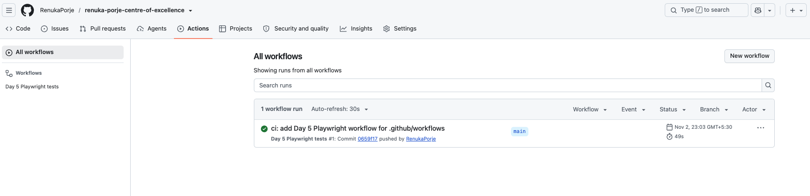
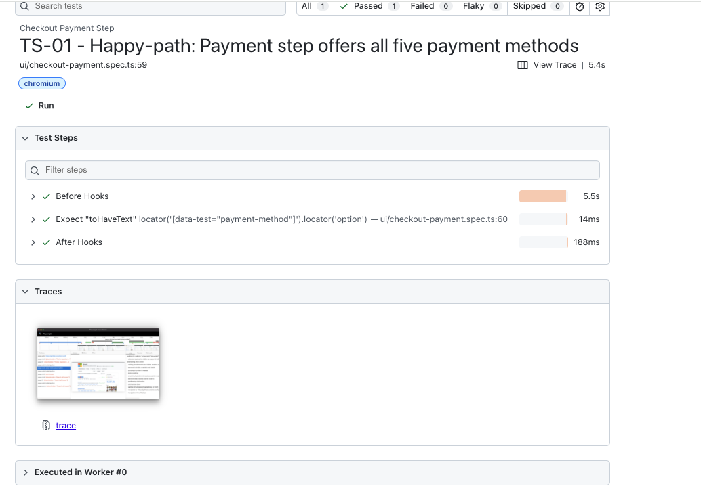
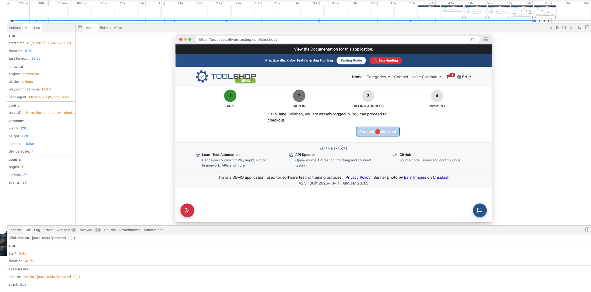
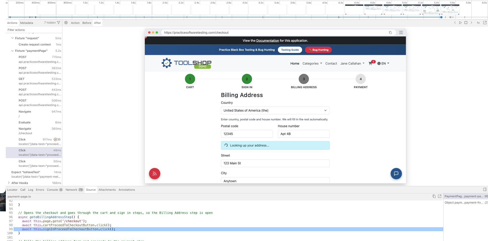
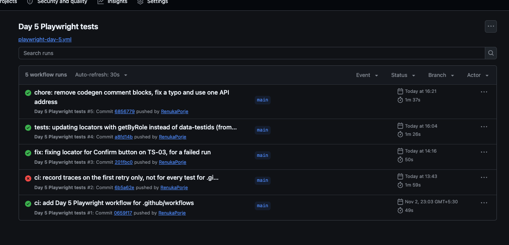
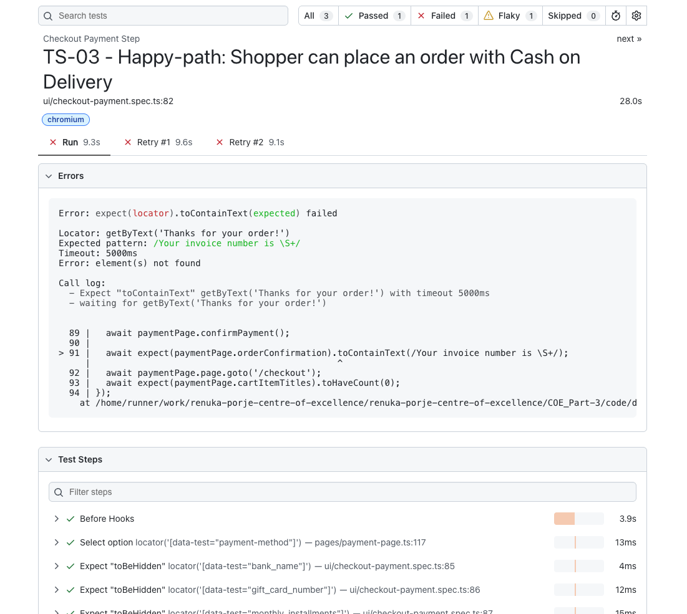
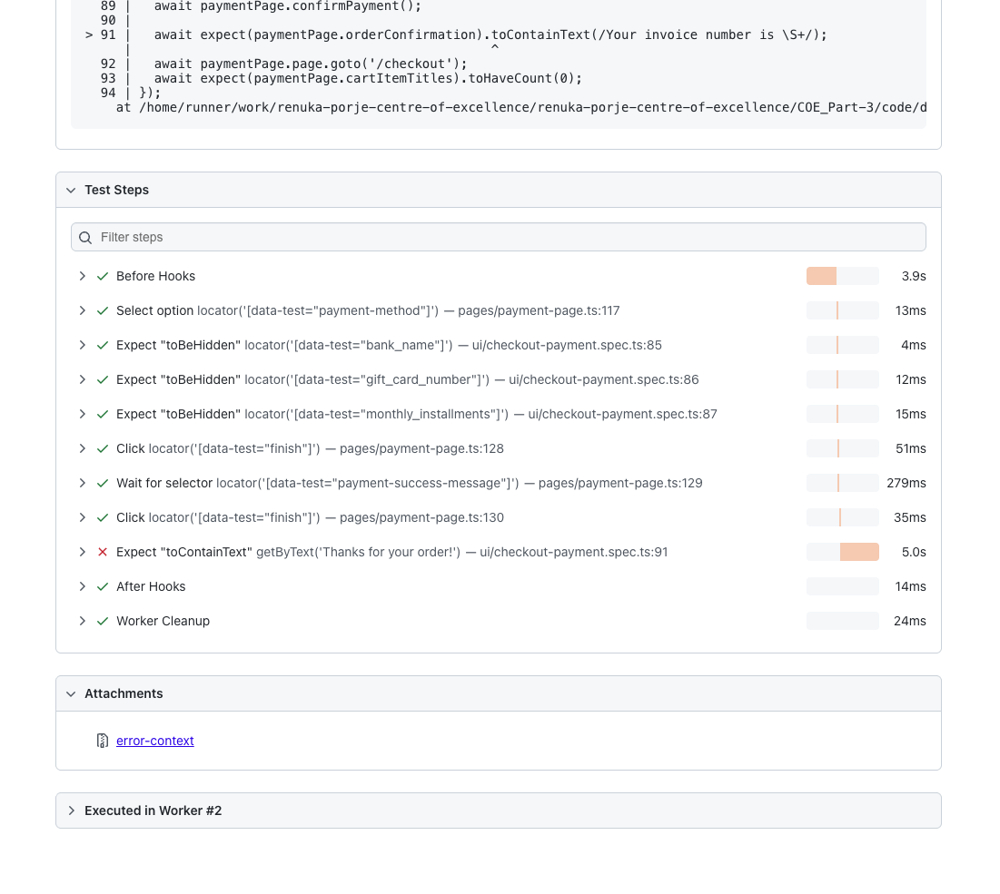
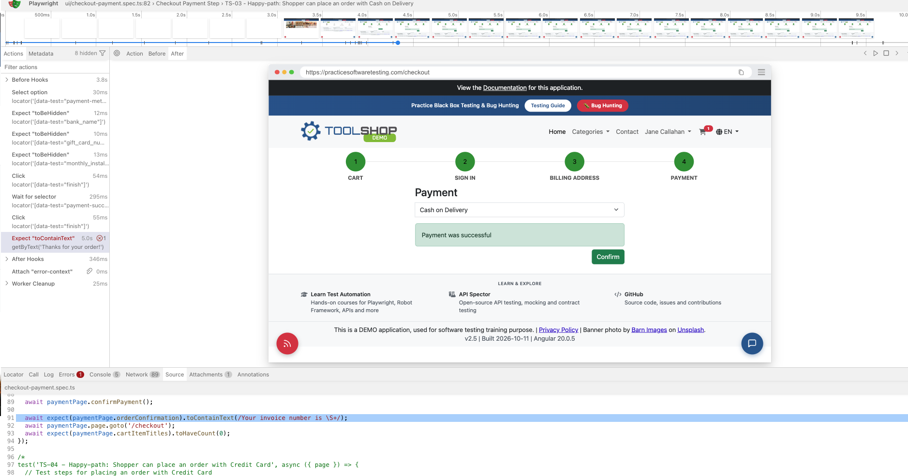

# Part 3 · Day 5: CI Reporting & Mini-Capstone

## Success criteria

| **Criterion** | **Done?** | **Evidence (link or section below)** |
|---|---|---|
| Runs the suite in a CI pipeline with a report and traces | Yes | [playwright-day-5.yml](../../.github/workflows/playwright-day-5.yml), [the report with the trace](assets/ci-report-trace.png). Section: Running Playwright tests in a CI pipeline |
| Reads a failed run using the trace viewer | Yes | [the failed run of TS-03 in the trace viewer](assets/ci-failed-run-trace-view.png), [the report with the failed test](assets/ci-failed-run-snap-1.png). Section: The trace viewer and reading a failed run |
| Connects pipeline checks to change failure rate | Yes | The reasoning from automated checks in the pipeline to the change fail rate, with its limits, using the [DORA metrics guide](https://dora.dev/guides/dora-metrics/) and the [Test automation capability page](https://dora.dev/capabilities/test-automation/). Section: How automated checks in a pipeline connect to the DORA metric change failure rate |
| Automates three scenarios and justifies what stays manual | Yes | [checkout-payment.spec.ts](../code/day-5/tests/ui/checkout-payment.spec.ts) with the 7 automated scenarios, and the reasoning for what stays manual. Section: Automating scenarios from the manual capstone |
| Presents the automation decisions with reasoning | Yes | A short walkthrough of what I automated, what stays manual and the reasoning. Section: The automation decisions and reasoning |
| Writes a comprehensive reflection | Yes | The reflection on the module, day by day, and where I want to grow. Section: Reflection |

## Exercises

### Running Playwright tests in a CI pipeline

**Core idea:** A CI pipeline runs the tests on a fresh machine every time something is pushed, so the result does not depend on my own setup. From what I understand, that machine needs the code, Node, the packages and the browsers before it can run anything. Once it has run the tests it keeps the outcome as an artifact, which is a file I can download afterwards. The HTML report is a page that lists every test with its status and its steps, and Playwright writes it to the `playwright-report` folder, so that folder is what gets kept. For CI Playwright recommends one worker and a global timeout, because a run that is stuck is stopped without producing a report.

**Scope:** A GitHub Actions pipeline that runs the Day 5 Playwright suite on every push, installs the browser, and publishes the HTML report with the traces ([playwright-day-5.yml](../../.github/workflows/playwright-day-5.yml)). The tests are in [code/day-5](../code/day-5/). I automated the first scenario, TS-01, first and ran the pipeline on every push while building the rest, so the runs below come from that suite.

**Result:** The first push started the pipeline and it passed, with 1 test passed. The workflow checks out the code, installs Node and the packages with `npm ci`, installs Chromium, runs the tests and then uploads the `playwright-report` folder as an artifact. For this first run I used `--trace on`, so that even a passing test records a trace. The HTML report and the traces are both inside the artifact. I downloaded it and opened it with `npx playwright show-report`, and TS-01 shows as passed with its trace attached. After that run I removed `--trace on`, so the pipeline now follows the config as `trace: 'on-first-retry'`, which records a trace only when a failed test is retried. That means the report of a passing run has no trace.

In the trace of TS-01 I could see the whole run in order. It starts with the five API calls of the setup (register, login, product search, create cart and add the item), and then the steps through the checkout up to the Payment step, with the check of the payment methods at the end. It took 5.7 seconds.

### The trace viewer and reading a failed run

**Core idea:** A trace is a recording of one test run, and the trace viewer lets me go through it after the run. It shows every action with its locator and how long it took, and the page before, during and after the action. It also shows the line of the test that ran, the console, the network calls and the errors. So for a failed test I can go to the exact step and see what the page looked like at that moment. For CI Playwright recommends `trace: 'on-first-retry'`, which records a trace only when a failed test is retried, because recording every test with `on` is heavy. A trace can be opened from the report, with `npx playwright show-trace`, or by dropping the file on trace.playwright.dev.

**Scope:** The failed run of TS-03, the Cash on Delivery order, in the pipeline after I pushed the order tests. I read it in the report and the trace.

**Result:** The report showed 3 tests: 1 passed, 1 failed and 1 flaky. TS-03 failed on the first run and on both retries, with `expect(locator).toContainText(expected) failed`. The element it could not find was `getByText('Thanks for your order!')`, which is the order confirmation message after the Confirm button, and it failed after the 5000 ms timeout. One test was marked as flaky, which I believe was TS-02, because a flaky test is one that fails first and then passes on a retry.

I picked up the error text first, and the trace then let me look at the actions and figure out which action or step it was failing at, which was the check for the order confirmation, waiting the full 5 seconds. Before that, the click on Check payment took about 50 ms, "Payment was successful" appeared, and the next click (`[data-test="finish"]`), which should have been Confirm, took about 40 ms and passed without an error. Both buttons have the same locator, so the trace cannot tell me for sure that this click landed on Confirm. The Before and After snapshots helped me see what the page looked like before and after the click. It was still on the Payment step, with Cash on Delivery chosen, "Payment was successful" showing and the Confirm button still there, so the order had not been placed. The Errors tab gives the exact error, and the Source tab highlights the line where the test fails, which is the check and not the cause, but it shows where to look. The error text is also there as an attachment, and the Log and Call tabs give some more information. So it is much easier to find, debug and fix a failure. Since the trace is set to `on-first-retry`, it is the trace of the first retry and not of the first run.

My first thought was my page object, because Check payment and Confirm were both `[data-test="finish"]`, as in the codegen output, so the click could have happened before the page changed the button to Confirm. I changed both to a button with its name, `getByRole('button', { name: 'Check payment' })` and `getByRole('button', { name: 'Confirm' })`, so Playwright waits for the Confirm button before it clicks. But when I tried Cash on Delivery by hand, it did not give me the invoice number at first and stayed on "Payment was successful", and a little later it worked. The Network tab of a later failed run showed the cause: `POST /invoices` returned 422, because the order was confirmed before the site had replaced the registered address with the result of its postcode lookup, and the server rejected the old address. Cash on Delivery has nothing to fill in, so TS-03 reaches Confirm first, and I believe the same timing is why one test showed as flaky. The retries and the flaky label in the report made it visible, and I fixed it by waiting for the postcode lookup to finish in the fixture before the test starts.

### How automated checks in a pipeline connect to the DORA metric change failure rate

**Core idea:** DORA's metrics are a way for teams to measure how well they deliver software, so that they can see where they are today, decide what to improve and check their progress as they go. There are five of them, and the [DORA metrics guide](https://dora.dev/guides/dora-metrics/) says they predict better organisational performance and better well-being for the team members.

The page calls them both leading and lagging indicators. A leading indicator signals a possible future change in a system, and a lagging indicator reflects past performance and outcomes. 

They are divided into throughput and instability. Throughput is a measure of how many changes can move through the system over a period of time, and a higher throughput means that more changes reach the production environment. It has three factors:

- Change lead time: the time it takes for a change to go from being committed to version control to being deployed in production.
- Deployment frequency: the number of deployments over a given period, or the time between deployments.
- Failed deployment recovery time: the time it takes to recover from a deployment that fails and needs immediate intervention.

Instability is a measure of how well the deployments go. When they go well, teams can confidently push more changes into production, and users are less likely to have issues right after a deployment. It has two factors:

- Change fail rate: the ratio of deployments that need immediate intervention after the deployment, which most likely ends in a rollback or a hotfix. For example, if 10 deployments went through and 2 of them needed a rollback or a hotfix, the change fail rate is 2 out of 10.
- Deployment rework rate: the ratio of deployments that are unplanned but happen as a result of an incident in production.

Taken together, throughput and instability give a high-level understanding of the software delivery performance, and measuring them over time shows how it is changing. They can be used for any application or service, whatever the tech stack, the complexity of the deployment process or the end users.

DORA's [Test automation capability page](https://dora.dev/capabilities/test-automation/) says that running tests continuously in the pipeline gives developers quick feedback, but the tests have to be reliable so that a pass means the software is releasable and gives confidence, and its research shows this improves software stability. I understand this, as where every push gave me a result on what had changed, allowing me to address it immediately, and TS-03 showed me what an unreliable result looks like.

As per my understanding, every change that is pushed goes through the pipeline and the checks run on it. If a check fails, the change is stopped and fixed before it gets deployed, so fewer bad changes reach production, which means fewer deployments need a rollback or a hotfix. This is the ratio that the change fail rate counts. For example, with no automated checks, if a change breaks the Payment step and it is deployed in production, it would need a rollback or a hotfix, and that counts as a failed deployment. If a check in the pipeline fails on that change, it is stopped and fixed before it is deployed. It goes to a test environment first and only then to production, so the issue never reaches production and never counts in the change fail rate.

In my pipeline the checks run on every push, and a failed test shows up in the report with its trace. TS-03 failed that way, but it was a timing problem between my test and the site, and not a bad change, which is the kind of false alarm that page warns about when it says not to tolerate flaky tests. My pipeline also does not deploy anything, so there is no real change fail rate to measure and it only shows how the connection would work. The checks only catch what the tests cover, which is the happy paths of the Payment step, so the rest depends on the manual testing. And the link from the checks to the change fail rate is my own reasoning built on those two pages, because DORA does not state it in one sentence.

### Automating scenarios from the manual capstone

**Scope:** The first 7 scenarios (TS-01 to TS-07) from the Part 2 Day 10 test scenarios ([checkout_payment_test_scenarios.md](assets/checkout_payment_test_scenarios.md)), with the test cases ([checkout_payment_Test_Cases.md](assets/checkout_payment_Test_Cases.md)) for reference. These are the happy paths of the Payment step, which comes after cart review and sign in.

- Automated: The 7 happy path scenarios are the end-to-end payment scenarios, with the payment path for each of the payment methods and the additional instalments in Buy Now Pay Later. They cover the core payment functionality. The requirements behind them (the methods offered, the order placed with an invoice number and the cart emptied) are High priority in my RTM, so I believe they can serve as a smoke test of the payment step on every push, running these core user flows, and also be a part of the regression suite, to make sure the core payment features still work as expected.
- Manual for now: The other scenarios stay manual in this capstone as of now. The remaining happy path scenarios (TS-08 to TS-11) could be automated first. The negative scenarios are specified and repeatable, so they could be automated after that, starting with the High priority ones (in capstone RTM), the card number form and the card expiry. After that the edge cases could be picked up. The Test Plan puts all of them after the happy paths, which is why I have parked them aside from automation as of now.
- Stays manual: Even when the edge cases are picked up, some of them would stay manual, especially the cases that have no defined expected result and need a human to judge, such as the back button, the refresh button on the payment page, double clicks, logout during a session, session timeout and concurrent sessions, along with exploratory testing around the handoff from the address step to the payment step. The exploratory session found defects this way, on empty card fields where the criteria say nothing, and a script cannot check a result that isn't a documented requirement.

**Result:** All 7 scenarios are automated and passing ([checkout-payment.spec.ts](../code/day-5/tests/ui/checkout-payment.spec.ts)), and they run in the pipeline on every push. TS-01 checks the five payment methods, and TS-02 to TS-06 each place an order with a method and check the invoice number and that the cart is gone afterwards, which is checked through the API. TS-07 is a group of three tests for 3, 9 and 12 monthly instalments, since 6 is already covered in TS-05. Each test sets up its own customer, login and cart through the API, and the page steps go through the payment step to order confirmation.

### The automation decisions and reasoning

- The manual capstone covered the Checkout Payment step with 33 scenarios, which are 11 happy path, 14 negative and 8 edge cases.
- I automated the 7 happy path scenarios, TS-01 to TS-07, which come to 9 tests because TS-07 has one test each for 3, 9 and 12 monthly instalments. They are the core payment journey with defined expected results, and the requirements behind them are High priority in my RTM, so together they work as a smoke test and can also be a part of a regression suite, run on every push, once the site builds newer changes to the payment step.
- Each test sets up its own customer, login and cart through the API and only the checkout steps go through the UI, which is why the tests do not depend on each other.
- The other happy path scenarios (TS-08 to TS-11) can be automated next. The negative scenarios and the edge cases (TS-12 to TS-33) stay manual for now. The negative ones are specified and repeatable, so they are what I would automate after that, starting with the High priority ones, the card number form and the card expiry, and the edge cases would come after that. My Test Plan also puts them after the happy paths.
- Some edge cases would stay manual even then, because they have no defined expected result. These are the back button, refresh, double clicks, session timeout and concurrent sessions, along with exploratory testing around the handoff from the address step to the payment step. My exploratory session found DEF-023 and DEF-025 that way, and a script cannot check a result that nobody has documented.
- The confirmation email also stays manual, since the tests cannot read the customer's mailbox.
- In the pipeline TS-03 failed on Confirm order and one test showed as flaky. The retries and the trace made that visible. I used stable role and name locators in the page object, and the cause was timing: the test confirmed before the site had finished the postcode lookup, and since the Cash on Delivery method has no additional fields to fill, Confirm gets clicked early and the order is not placed, so the fixture now waits for the postcode lookup before the test starts.
- Next I would automate the remaining happy path scenarios, then the negative scenarios, then the edge cases that have a defined result, and keep manual testing for what a script cannot judge.

## Reflection

On Day 1, I learned how TypeScript works with interfaces, modules and types, and how the compiler catches errors before the code runs. I also understood why it suits Playwright. Playwright ships its own types, so the compiler and the editor check how I call its API and give autocomplete, though they cannot check what is on the page. Writing my first Playwright tests with locators and web-first assertions on a demo site gave me confidence, since until then I had only worked through foundations.

On Day 2, I rewrote a Postman collection with positive and negative tests as Playwright tests. That is where I came across the `request` fixture, and how setting up test data and pre-conditions through API calls is much quicker than going through the UI. It also helped me see what is better left as a Postman check, what can be a Playwright test, and where API automation adds more value in speed and feedback. It built on what I already knew about API testing, collection runs and Newman, and automating end to end with Playwright was something I had wanted to learn, so this was a good start.

On Day 3, I focused on the page object model, and it showed me the structure and stability to aim for and how to refactor tests for readability and maintenance. Poor locators and shared state or data across tests cause flaky tests. I also learned which locators Playwright recommends and why. Test isolation was the main lesson, because each test should set up its own data and not depend on another.

On Day 4, Cucumber was completely new to me, both as a concept and in how it works with Playwright, so this was the part I struggled with most. I understood step definitions, how to make them reusable through parameters, and how to keep the UI mechanics in the page object and out of the steps, so the scenarios stay readable. In the BEE exercise it reused four of the five steps and created only the missing one. Its first run failed because it used the API’s wording from the error I gave it and not the UI’s, so I take it as a draft that I review.

On Day 5, the trace viewer was the most interesting thing I learned. It shows the duration of each action, the page before and after it, and the source, errors and logs, so I can go to the exact step that failed, which really matters when you have a large suite and complex tests failing. Setting up the GitHub Actions workflow showed me how the configuration, the `.yaml` file and the flags fit together, and I understand the implementation much more in depth than before. With it every change I push is tested straight away, so a problem is caught early and can be dealt with at once. The failure of TS-03 showed me that a red run is not always a bad change, because it was a timing problem between my test and the site, which is why retries and the trace help. Connecting the checks to the DORA change fail rate helped me see why a pipeline matters, and its limit, since the checks only catch what the tests cover. In the capstone, deciding what to automate and what to leave manual, and justifying it, was as useful as the automation itself.

Overall, this module added great value to my upskilling goals and has been a fulfilling experience. Going forward, I want to build more depth in Playwright with TypeScript, practise and automate more, and keep working towards end to end automation across UI and API. I will pay more attention to the page object model and fixtures, because the implementation can get tricky when starting out. I also want to keep working hands-on with GitHub Actions, come back to Cucumber with Playwright once I am more confident, and take up books on behaviour-driven development. I would also like to explore the Incubyte AI plugins and how to use them effectively in my process.

## AI use

- First and second review of the tests, page objects and fixtures
- First and second review of the write up.
- Debugging a failing test such as TS-03 failure: Claude read the Network data in the failed trace, which showed the 422 on POST /invoices and the late postcode lookup, it suggested waiting for the lookup in the fixture.
- As I insisted the /checkout check for the empty cart after the order is not a reliable check, it suggested checking the cart through the API (if cart id check gives 404 now since order is placed)
- For assisting and understanding of certain areas for implementation like fixtures, helper and github actions workflow.
- Understanding examples of DORA metrics.
- Final review of the document for links, errors or missing assets, markdown file.
